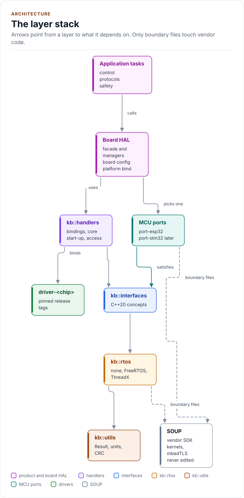

# kb-core

[](https://github.com/kokeb-labs/kb-core/actions/workflows/ci.yml)
[](LICENSE)
[](https://kokeb-labs.github.io/kb-core/)

**Start from the chip, not from the glue code.** kb-core sits between the Kokeb Labs chip drivers and a board HAL:
C++20 utilities, an RTOS wrapper (FreeRTOS, ThreadX or none), bus and pin contracts written as concepts, a DMA
buffer and stream model, and one handler per driver that gives every chip the same start-up, health and thread
behaviour. Five parts, each its own CMake target, one version. No heap, no exceptions, MISRA C++:2023 checked in
CI, built for IEC 62304 Class C evidence.

> **Status: release candidate.** [v0.1.0-rc.2](https://github.com/kokeb-labs/kb-core/releases/tag/v0.1.0-rc.2) is
> the second release candidate: the parts, DMA assignment from a declared board, 23 pinned chip drivers, the ESP32 and
> host ports and the port SDK, tested in CI. APIs may still change before 0.1.0.

## Quick start

Pick a chip, then enable only its driver. This builds the PCAL9555 I/O-expander handler and its tests on your
computer (CMake 3.25 or later, a C++20 compiler):

```bash
git clone https://github.com/kokeb-labs/kb-core.git && cd kb-core
git submodule update --init components/drivers/driver-pcal9555
cmake -S . -B build -DKB_BUILD_TESTS=ON -DKB_ENABLE_PCAL9555=ON
cmake --build build -j && ctest --test-dir build
```

Each handler has a page in [`docs/handlers/`](docs/handlers/) (what it needs from the HAL, the start-up plan, the
error map). The hosted [configurator](docs/configurator.md) resolves a chip, MCU and RTOS choice into a pinned,
repeatable project. Full documentation: <https://kokeb-labs.github.io/kb-core/>.

<!-- figure: layer-stack -->
<picture>
  <source media="(prefers-color-scheme: dark)" srcset="docs/diagrams/layer-stack.dark.svg">
  
</picture>
<!-- /figure -->

## Why kb-core

- **One contract per bus, checked at compile time.** C++20 concepts only, no virtual functions, no heap, no
  exceptions ([ADR-0006](docs/adr/ADR-0006-concepts-only.md)).
- **Layering that CI enforces.** Applications reach hardware only through their HAL; SDK and RTOS headers only in
  listed boundary files ([layering rules](docs/layering.md)).
- **Handlers that behave the same for every chip.** One start-up pipeline of declared stages, health states, and
  a thread model declared per bus: an owner task with snapshots, or a lock-guarded facade
  ([handlers](docs/design/handlers.md)).
- **Pinned, explainable releases.** Drivers pinned to release or rc tags only; each release records its own SHA,
  every pin, an SBOM, a CVE scan and a licence report ([versioning](docs/versioning.md)).

## Parts

| Part | Target | What it holds | Who may use it |
| --- | --- | --- | --- |
| [utils](components/lib/utils/README.md) | `kb::utils` | Error model, time units, containers, CRCs, numerics | Everyone |
| [rtos](components/lib/rtos/README.md) | `kb::rtos` | Sleeps, locks, queues, CRTP threads, liveness; FreeRTOS, ThreadX or no RTOS | Everyone |
| [dma](components/lib/dma/README.md) | `kb::dma` | DMA buffers with a CPU/device lease, cache-policy regions, copy-out streams | Ports, handlers |
| [interfaces](components/lib/interfaces/README.md) | `kb::interfaces` | Bus and pin contracts (C++20 concepts), host test port | The HAL, handlers and MCU ports |
| [handlers](components/lib/handlers/README.md) | `kb::handlers` | Driver bindings, handler core, start-up pipeline, access facades | The HAL only |
| [components/ports/esp32](components/ports/esp32/README.md) | `kb::port_esp32` | ESP-IDF implementations of the contracts (own CMake project) | The HAL |

## Build

```bash
cmake -S . -B build                          # host: KB_MCU=HOST, KB_RTOS=NONE, every part, no driver
cmake -S . -B build -DKB_PARTS=rtos          # one part and its dependencies
cmake -S . -B build -DKB_ENABLE_PF1550=ON    # bind a driver (init components/drivers/driver-pf1550 first)
```

The configure prints the selected MCU, RTOS, parts and drivers. Every setting is described in
[`cmake/kb_build_settings.cmake`](cmake/kb_build_settings.cmake). The ESP32 port builds as its own project
([components/ports/esp32](components/ports/esp32/README.md)).

## Repository layout

| Folder | Holds |
| --- | --- |
| [`components/lib/`](components/lib/README.md) | The five parts: `utils`, `rtos`, `dma`, `interfaces`, `handlers` |
| [`components/ports/`](components/ports/README.md) | MCU family ports (`esp32`) and the host port (`host`) |
| `components/drivers/` | Driver submodules, pinned to release or rc tags |
| [`examples/`](examples/README.md) | Programs built in CI and shown in the documentation; the example index |
| `catalog/` | `compat.yml` and the JSON schemas in `catalog/schemas/` |
| `tests/`, `tools/`, `docs/`, `configurator/` | Repository tests, tools, the site, the hosted configurator |
| `_config/`, `cmake/`, `deviations/`, `.kokeb/`, `.github/` | Organisation-wide conventions kept at the root |

Where each of these lives is named once, in `tools/layout/paths.yml`; the same file lists what may sit at the root.

## Documentation

| | |
| --- | --- |
| [Architecture](docs/architecture.md) | Layers, parts and one call traced from HAL to chip |
| [Plan](docs/design/plan.md) | The design on one page: decisions, phases M0 to M7, risks, open items |
| [Handlers](docs/design/handlers.md) | Start-up pipeline, lifecycle and health, thread models |
| [MCU ports and repositories](docs/design/ports.md) | The port seam and the names of the kb repository family |
| [Assurance](docs/design/assurance.md) | Level `high`, the MISRA C++:2023 claim and how it is verified |
| [Configurator](docs/design/configurator.md) | The hosted configurator and the evidence it hands out |
| [Layering rules](docs/layering.md) | What may include what, and how CI enforces it |
| [Port contracts](docs/port-contracts.md) | The interface concepts and the driver ports they serve |
| [Assembler and resolver](docs/design/assembler.md) | kb-core as the assembler: catalogue, image, lock and the shared resolver rules |
| [The kb tool](docs/kb-tool.md) | `kb catalog build`, `kb resolve`, `kb sbom` |
| [Decisions](docs/adr/README.md) | ADR index |

The site is published at <https://kokeb-labs.github.io/kb-core/>. Build it locally: `mkdocs build -f _config/mkdocs.yml --strict`.

## Contributing and security

[Contributing](.github/CONTRIBUTING.md) and [security policy](.github/SECURITY.md). Contact:
<kokeblabs@gmail.com>.

## License

MIT, see [LICENSE](LICENSE). Copyright (c) 2026 The kb-core authors.
