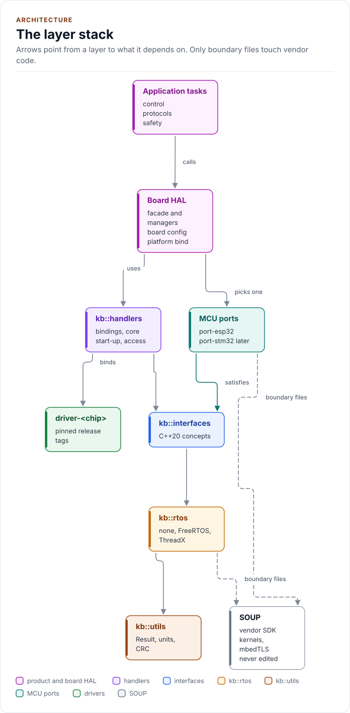
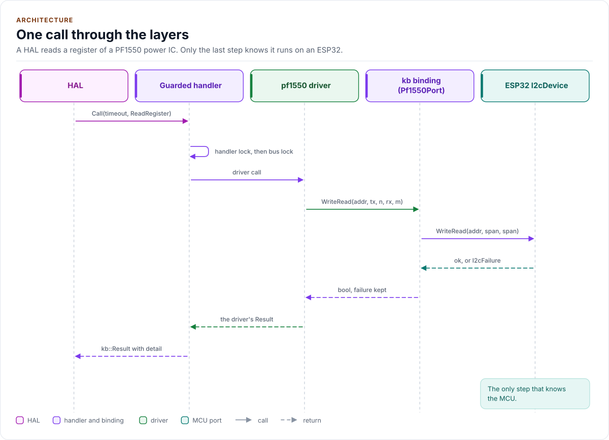

# Architecture

Where kb-core sits, what each part holds, and the path one call takes from a HAL to a chip.

## Layers

<!-- figure: layer-stack -->
<picture>
  <source media="(prefers-color-scheme: dark)" srcset="diagrams/layer-stack.dark.svg">
  
</picture>
<!-- /figure -->

| Layer | Depends on | Knows the MCU? |
| --- | --- | --- |
| Application | HAL public headers, `kb::utils`, `kb::rtos` | No |
| Board HAL | `kb::handlers`, `kb::interfaces`, `kb::rtos`, `kb::utils`, one MCU port | In its platform files only |
| `kb::handlers` | drivers, `kb::interfaces` contracts, `kb::rtos`, `kb::utils` | No |
| `kb::interfaces` | `kb::rtos`, `kb::utils` | No (the host test port is platform-free) |
| `kb::rtos` | `kb::utils`; the RTOS only in `backends/<rtos>/` | Only its backends |
| `kb::utils` | nothing | No |
| MCU port (`components/ports/<mcu>/`) | installed `kb::interfaces`, `kb::rtos`, `kb::utils`; the SDK in its boundary files | Yes, it is the MCU seam |
| drivers | their own port concept | No |

## One call through the layers

A HAL reads a register of a PF1550 power IC. Only the last step knows it runs on an ESP32.

<!-- figure: call-sequence -->
<picture>
  <source media="(prefers-color-scheme: dark)" srcset="diagrams/call-sequence.dark.svg">
  
</picture>
<!-- /figure -->

## Build selection

`cmake/kb_build_settings.cmake` selects everything kb-core builds: `KB_MCU` picks the MCU gate and the default
RTOS, `KB_RTOS` the one backend, `KB_PARTS` the parts (dependencies added), `KB_ENABLE_<DRIVER>` the drivers, and
the MCU gate table (`cmake/kb_mcu_gates.cmake`) stops a configure that enables a driver its MCU cannot run (the
WS2812 driver needs the ESP32 RMT peripheral). kb-core compiles no MCU source: the MCU port is its own project. No
platform macro is produced: code never tests the MCU.

## Design pages

[Plan](design/plan.md) · [Handlers](design/handlers.md) · [MCU ports and repositories](design/ports.md) ·
[Assurance](design/assurance.md) · [Configurator](design/configurator.md) · [Design rules](design/rules.md)

Next: [Layering rules](layering.md).
