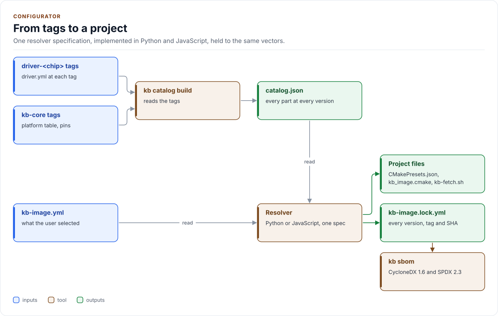

# Assembler and resolver

kb-core assembles an image from its own libraries and pinned parts
([ADR-0014](../adr/ADR-0014-kb-core-is-the-assembler.md)). This page is the **resolver specification**: the one
set of rules that the `kb` command line (`tools/kb/resolver.py`) and the configurator site
(`configurator/resolver.mjs`) implement, and that the shared vectors in `tests/resolver/vectors/` hold them to.
The [upgrade planner](#upgrades) (`tools/kb/upgrade.py`, `plan` in `configurator/resolver.mjs`) is part of the same
specification and has its own vectors in `tests/resolver/vectors/upgrade/`.

<!-- figure: assembler-flow -->
<picture>
  <source media="(prefers-color-scheme: dark)" srcset="../diagrams/assembler-flow.dark.svg">
  
</picture>
<!-- /figure -->

## Documents

| Document | Schema | Written by | Read by |
| --- | --- | --- | --- |
| Catalogue | [`catalog/schemas/catalog.schema.json`](https://github.com/kokeb-labs/kb-core/blob/main/catalog/schemas/catalog.schema.json) | `kb catalog build`, the release job | the resolver |
| Image | [`catalog/schemas/kb-image.schema.json`](https://github.com/kokeb-labs/kb-core/blob/main/catalog/schemas/kb-image.schema.json) | the user, the site | the resolver |
| Lock | [`catalog/schemas/lock.schema.json`](https://github.com/kokeb-labs/kb-core/blob/main/catalog/schemas/lock.schema.json) | the resolver, the release job | `kb sbom`, the fetch script, people |
| `driver.yml` | [`catalog/schemas/driver-yml.schema.json`](https://github.com/kokeb-labs/kb-core/blob/main/catalog/schemas/driver-yml.schema.json) | each driver repository | `kb catalog build` |

All three carry `schema: 1`. JSON is the exchange format; YAML is accepted where a person writes the file.

### Catalogue

Every part that may be assembled, at every selectable version:

- `kb_core`: repository, licence, authors and its versions (`release`, `rc`, or `dev` for an unreleased revision
  added with `--include-head`).
- `parts`, `rtos` (each `supported` or `planned`) and `mcus`: family, status, targets, the RTOS backends it
  allows, its default RTOS and its port. A port with an empty `versions` list is inside kb-core (`path`); an
  extracted port lists the tags of `kokeb-labs-drivers/port-<family>`. A family without a port has `port: null`.
- `drivers`: name, repository, folder, kb-core's own pin (`pinned`), and per tag the version, commit, kind, buses,
  MCU families (`[any]` or a list), peripheral, `kb_core_min`, `requires_owner` (`kRequiresOwner`), licence,
  authors and optional `bindings`, all read from `driver.yml` at that tag. Until a kb-core release records its
  binding facts, `kb catalog build --platforms configurator/data/platforms.json` adds `requires_owner` from that
  file's `bindings` map.
- Optional on any version: `osv`, its known-vulnerability scan (`scanned_at`, `database`, `findings`); on a kb-core
  version: `bindings`, the drivers it has a handler binding for. The resolver reads neither; `kb sbom` and the site
  report the scans.
- Optional on a driver or kb-core version: `language`, its language floor (`standard`, `profile`, `compilers`,
  `tested`, `source`), copied from `driver.yml` (or kb-core's `kb.yml`) at that tag; a tag without the block records
  the registry default, C++20 with profile KB-CPP20 (`source: default`). An entry without the field is read the same
  way ([Language floor](../language-floor.md)).

### Image

```yaml
schema: 1
image: example-board-a            # [a-z0-9][a-z0-9-]*, default kb-image
kb_core: {version: 0.4.0}
mcu: {family: esp32, target: esp32s3, port: {version: 0.5.0}}   # target and port optional
rtos: freertos                    # optional: the family's default
language: {standard: 20, compilers: {gcc: "12"}}   # optional: the project's C++ standard and compilers
drivers:
  - pcal9555                      # kb-core's pin, else the newest release, else the newest rc
  - {name: tmc5160, version: 0.1.0-rc.2}
buses:
  i2c0: {model: guarded, devices: [pcal9555]}
  spi1: {model: owner, devices: [tmc5160]}   # kind from the name, or kind: spi
```

## Rules

Resolution has two phases. **Shape** checks the image alone; if it finds anything, resolution stops with those
errors. **Semantics** then checks every rule and reports every error it finds, not only the first. Errors and
warnings are sorted by code, then subject.

### Shape

| Field | Rule | Code, subject |
| --- | --- | --- |
| the document | a mapping | `KB-RES-001`, `$` |
| any mapping | no field outside the schema | `KB-RES-022`, the field's path |
| `schema` | the integer 1 (a number with no fraction) | `KB-RES-001` if missing or not an integer, `KB-RES-021` if another integer |
| `image` | a name `[a-z0-9][a-z0-9-]{0,62}` | `KB-RES-001`, `image` |
| `kb_core.version`, `mcu.family` | strings | `KB-RES-001`, the path |
| `mcu.target`, `mcu.port.version`, `rtos` | strings when present | `KB-RES-001`, the path |
| `drivers[i]` | a name, or `{name, version?}` with strings | `KB-RES-001`, `drivers[i]` or `drivers[i].name` |
| `buses.<name>` | name `[a-z][a-z0-9_]{0,31}`; `{model, devices, kind?}`; devices are strings | `KB-RES-001`, the path |
| `language` | `{standard, compilers?}`: 17, 20, 23 or 26; `compilers`: `gcc`, `clang`, `msvc`, `arm_gcc`, `esp_idf` | `KB-RES-001`, `KB-RES-022` |

### Semantics

1. **kb-core**: the version must be in the catalogue (`KB-RES-002`, `kb_core.version`). An rc warns
   (`KB-RES-W01`, `kb-core`); a dev revision warns (`KB-RES-W03`, `kb-core`).
2. **MCU**: the family must exist (`KB-RES-003`) and be supported with a port (`KB-RES-004`), subject
   `mcu.family`. The target defaults to the family's first and must be one of its targets (`KB-RES-005`,
   `mcu.target`).
3. **RTOS**: defaults to the family's. It must exist (`KB-RES-006`), be implemented (`KB-RES-007`: a backend that is
   planned, not yet available) and be allowed on the family (`KB-RES-008`: ESP-IDF needs FreeRTOS); subject `rtos`.
4. **Port**: an extracted port takes the image's version or the default rule, which must exist (`KB-RES-020`,
   `mcu.port.version`; an rc warns `KB-RES-W01`, `port-<family>`). An in-tree port has kb-core's version; naming
   another is `KB-RES-020`.
5. **Drivers**, subject the driver name: listed once (`KB-RES-010`); in the catalogue (`KB-RES-009`); a requested
   version is `X.Y.Z` or `X.Y.Z-rc.N` (`KB-RES-012`) and exists (`KB-RES-011`, also when a driver has no version at
   all). The default version is kb-core's pin when that tag is catalogued, else the newest release, else the newest
   rc. An rc warns (`KB-RES-W01`). The MCU gate: the version's `mcus` holds `any` or the family (`KB-RES-013`).
   `kb_core_min`, when set, is not above the selected kb-core (`KB-RES-014`).
6. **Buses** ([ADR-0009](../adr/ADR-0009-handler-thread-models.md)), in name order, subject `<bus>/<device>`
   unless noted: the model is `owner` or `guarded` (`KB-RES-015`, `buses.<bus>.model`); an explicit `kind` is a
   known bus kind (`KB-RES-023`, `buses.<bus>.kind`), otherwise the kind comes from a name like `i2c0`, `spi1` or
   `uart2`, or stays unknown; a device appears once per bus (`KB-RES-010`) and is a listed driver (`KB-RES-016`);
   a `requires_owner` chip is not on a guarded bus (`KB-RES-018`); a known kind is one of the driver version's
   buses (`KB-RES-019`). A device on more than one bus is `KB-RES-017`, subject the device: one chip, one bus, one
   thread model.
7. **Language** ([Language floor](../language-floor.md)), only when the image has a `language` block: kb-core's
   floor (`standard` above the image's is `KB-RES-024`, subject `kb-core`) and each driver version's floor (subject
   the driver name) are checked; a compiler the image names whose floor in the part is newer is `KB-RES-025`. Each
   such error carries `alternative`: the newest catalogued version (a release, else an rc; never dev) that fits, or
   `null`. A driver named **without** a version whose default does not fit takes that alternative instead and warns
   `KB-RES-W04` (with the same `alternative`); only when nothing fits is it an error. A part with no language block
   is read as C++20 with the KB-CPP20 compiler floors. Compiler versions are quoted strings such as `"12.2"`.

### Versions

Tags are `vX.Y.Z` or `vX.Y.Z-rc.N` only. Order: by `X`, `Y`, `Z`, then a release after every rc of the same
`X.Y.Z`, rcs by `N`. In a driver's catalogue entry the version is the tag without `v` (`0.1.0-rc.1`); its
`driver.yml` carries the release it is a candidate for (`0.1.0`), which `kb catalog build` checks (PIN-006).

### Lock

For a valid image: `schema`, `image`, `kb_core` (version, repository, tag, commit, kind, licence, authors), `mcu`
(family, target), `rtos`, `parts` (`utils`, `rtos`, `interfaces`, and `handlers` when a driver is selected),
`ports` (one entry), `drivers` (sorted by name), `buses` (sorted by name, devices sorted) and `cmake` (`KB_MCU` and
`KB_RTOS` upper-case, `KB_PARTS` joined by `;`, `KB_ENABLE_<NAME>` `ON` per driver). When the image has a `language`
block, the lock also records it (`language`: `standard` and the sorted `compilers`, `{}` when none) and `cmake` gains
`KB_CPP_STANDARD`; without one, both are absent, so the files of an image without the block do not change.

### Emitted files

Byte-for-byte the same from both implementations:

| File | Content |
| --- | --- |
| `kb-image.lock.yml` | One comment line, then the lock as canonical JSON (sorted keys, two-space indent, final newline); JSON is YAML, so any YAML or JSON parser reads it |
| `CMakePresets.json` | Presets version 6, one configure preset named after the image with the `cmake` values |
| `kb_image.cmake` | `set()` of `KB_MCU`, `KB_RTOS`, `KB_PARTS`, each `KB_ENABLE_*` in name order, then each `KB_DRIVER_<NAME>_DIR` as `${CMAKE_CURRENT_LIST_DIR}/external/drivers/<folder>` (the file sits at the project root) |
| `kb-fetch.sh` | POSIX shell, run inside the user's git repository: adds kb-core, an extracted port and each driver as submodules under `external/` (layout below), fetches each tag, refuses it when it no longer names the locked commit, checks out the commit (a dev kb-core: fetched by commit), removes any `branch` entry, stages the result; `--verify` only checks that every submodule is at its commit |

### Layout

One layout for every user project:

```text
<project>/
├── kb-image.yml, kb-image.lock.yml, kb_image.cmake, CMakePresets.json, kb-fetch.sh
└── external/
    ├── kb-core/                 at its tag (an in-tree port is inside it: external/kb-core/components/ports/<family>)
    ├── port-<family>/           an extracted port, at its tag
    └── components/drivers/driver-<chip>/   each selected driver, at its tag
```

Drivers sit beside kb-core, not inside it: a submodule of the project cannot hold another submodule of the same
project. The presets fragment carries the same `KB_DRIVER_<NAME>_DIR` values with `${sourceDir}`.

## Upgrades

`kb outdated`, `kb upgrade` and the site's *Open an existing project* view plan an upgrade with one pure function
of (catalogue, image, optional lock, targets, `allow_rc`). Neither front end reads a file, a clock or the network
while planning; the result is the same rows, codes, new image, lock and report bytes from both.

1. **Current versions.** With a lock, every version comes from it (kb-core, an extracted port, each driver): an
   image may leave versions out, and "today's default" moves as the catalogue grows. A lock that disagrees with
   the image, names a driver the image lacks, misses one it has, or is not a schema-1 lock is `KB-UPG-002`.
   Without a lock, unnamed versions are the resolver's defaults today. The current image must resolve
   (`KB-UPG-001`, followed by the resolver's own errors). Where the lock's `commit` (or `kind`) for a version
   differs from the catalogue's entry of that version (a kb-core development revision whose version has since been
   tagged, so the catalogue lists only the release; a moved tag; a lock from another catalogue), the row's `from`
   kind is the lock's, the row changes (`lock_differs`) and `KB-UPG-W04` names both commits.
2. **Targets.** `to` maps `kb-core`, `port-<family>` (an extracted port; an in-tree port moves with kb-core) or a
   driver name to a version. An unknown name is `KB-UPG-003`; a version not in the catalogue (or not a version)
   `KB-UPG-004`; one older than the current version `KB-UPG-005`. A named target may be a release candidate or a
   kb-core development revision; it must pass the driver gates below, else the gate's resolver code is the error.
3. **Order.** kb-core first, then an extracted port, then each driver in name order, because the drivers'
   `kb_core_min` is checked against kb-core's new version.
4. **Candidates.** Without a target: the catalogued versions above the current one (at or above it for a dev
   revision, so its release replaces it) of kind `release`, plus `rc` with `allow_rc`; never `dev`. A dev revision
   `X.Y.Z` is not offered its own `X.Y.Z-rc.N`, which sorts below it (a policy choice: a dev build is ahead of its
   candidates). Newest first,
   the first that passes the gates is taken; each newer one that fails is recorded as *held back* with the code of
   its first failing gate. No candidate: the current version stays.
5. **Driver gates**, in this order, the resolver's own rules: MCU family (`KB-RES-013`), `kb_core_min` against the
   new kb-core (`KB-RES-014`), a `requires_owner` chip on a guarded bus (`KB-RES-018`), the bus kind in use
   (`KB-RES-019`), and, when the image has a `language` block, its standard and compilers (`KB-RES-024`,
   `KB-RES-025`; kb-core's candidates pass this gate too).
6. **New image.** The image with every version explicit (kb-core, an extracted port, each driver, drivers sorted by
   name), everything else unchanged; it is resolved again and its lock and files are the plan's. Its warnings
   (`KB-RES-W01`, `KB-RES-W03`) join the plan's.
7. **Rows**, one per component (kb-core, an extracted port, each driver): `from` and `to` with their kinds,
   `change` (`none`, `major`, `minor`, `patch`, `prerelease` when only the rc number or the kind changes, or
   `commit` when only the lock's commit differs), `lock_differs`,
   `breaking`, the newest release and a newer rc, the held-back versions, the known-vulnerability ids of both
   versions (`null` when not scanned), the ids the upgrade fixes, and the release page of the new tag.
8. **Breaking** follows SemVer: a new major; before 1.0 a new minor, and before 0.1 a new patch. An rc moving to its
   own release is not breaking. Breaking rows warn `KB-UPG-W01`, held-back versions `KB-UPG-W02`, remaining known
   vulnerabilities `KB-UPG-W03`.

Both front ends read the same catalogue: the `kb` tool takes kb's `catalog.json` or the configurator's
`data/catalog.json`, which it converts field for field as the site does (`from_site` in `tools/kb/catalog.py`,
`kbCatalog` in `configurator/js/shared.js`, compared by a test on the shipped catalogue). Per-version facts
(`requires_owner`, `osv`) are carried in both.

Emitted files of a successful plan, byte-for-byte the same from both implementations: `kb-image.yml` (one fixed
style: block keys, flow values, every string double-quoted, so any YAML parser reads back the plan's image), the
lock and the three files of [Emitted files](#emitted-files), and `kb-upgrade.md` (a table of the rows, breaking
changes with their release pages, held-back versions, fixed and remaining vulnerabilities, warnings, next steps).

## Codes

| Code | Meaning |
| --- | --- |
| `KB-RES-001` | Malformed image: a field is missing or has the wrong type |
| `KB-RES-002` | Unknown kb-core version |
| `KB-RES-003` | Unknown MCU family |
| `KB-RES-004` | The MCU family has no port yet |
| `KB-RES-005` | Unknown target of the MCU family |
| `KB-RES-006` | Unknown RTOS |
| `KB-RES-007` | The RTOS backend is planned but not implemented yet (none today; ThreadX was until ADR-0015) |
| `KB-RES-008` | The RTOS is not available on the MCU family |
| `KB-RES-009` | Unknown driver |
| `KB-RES-010` | A driver or bus device is listed twice |
| `KB-RES-011` | The driver has no such version, or no version at all |
| `KB-RES-012` | Not a version: `X.Y.Z` or `X.Y.Z-rc.N` |
| `KB-RES-013` | MCU gate: the driver needs another MCU family |
| `KB-RES-014` | The driver version needs a newer kb-core (`kb_core_min`) |
| `KB-RES-015` | Unknown thread model: `owner` or `guarded` |
| `KB-RES-016` | A bus device is not an enabled driver |
| `KB-RES-017` | A device is declared on more than one bus |
| `KB-RES-018` | The chip requires the owner-task model (`kRequiresOwner`) but its bus is guarded |
| `KB-RES-019` | The driver version does not support the bus kind |
| `KB-RES-020` | Unknown port version |
| `KB-RES-021` | Unsupported image schema |
| `KB-RES-022` | Unknown field |
| `KB-RES-023` | Unknown bus kind |
| `KB-RES-024` | The part needs a newer C++ standard than the image's `language.standard` |
| `KB-RES-025` | The part needs a newer compiler than the image's `language.compilers` |
| `KB-RES-030` | Unsupported catalogue schema |
| `KB-RES-031` | Availability only: the driver needs a peripheral the target does not offer |
| `KB-RES-032` | Availability only: the driver needs a bus the target does not offer |
| `KB-RES-033` | Availability only: the driver needs another RTOS |
| `KB-RES-W01` | A release-candidate pin is selected |
| `KB-RES-W03` | kb-core is an unreleased development revision |
| `KB-RES-W04` | An older driver version is used: the default one needs a newer C++ standard or compiler |

### Upgrade codes

| Code | Meaning |
| --- | --- |
| `KB-UPG-001` | The current image does not resolve against this catalogue |
| `KB-UPG-002` | The lock is not a lock of this image |
| `KB-UPG-003` | A target names a component that is not in the image (or an in-tree port) |
| `KB-UPG-004` | A target names a version that is not in the catalogue |
| `KB-UPG-005` | A target is older than the current version (a downgrade) |
| `KB-UPG-W01` | A breaking change: a new major version, or a new minor (or patch) before 1.0 |
| `KB-UPG-W02` | A newer version exists but a gate holds it back |
| `KB-UPG-W03` | Known vulnerabilities remain after the upgrade |
| `KB-UPG-W04` | The lock pins a different commit (or kind) than the catalogue has for that version |

## Vectors

`tests/resolver/vectors/NNN-<case>.json`: a description, the catalogue (a file under `catalogs/` or inline), the
image, and the expectation (`ok`, the codes and subjects of errors and warnings with the `alternative` of those that
name one, and for a valid image the lock and every emitted file). `tools/kb/tests/test_vectors.py` and
`tests/resolver/run_js_vectors.mjs` run them all; CTest
runs both (`kb_cli_unit`, `kb_resolver_js_vectors`). Every code above appears in at least one vector, which a test
checks.

`tests/resolver/vectors/upgrade/NNN-<case>.json`: a description, the catalogue (`../catalogs/upgrade.json` and
others, or inline), the image, an optional lock, `options` (`to`, `allow_rc`) and the expectation (`ok`, codes and
subjects, the rows, the new image and lock, and every emitted file). `tools/kb/tests/test_upgrade.py`,
`tests/resolver/run_js_upgrade_vectors.mjs` (run by `run_js_vectors.mjs`) and `configurator/tests/project.test.mjs`
run them; every upgrade code appears in a vector, and a seeded test feeds the same mutated images, locks and
targets to both planners.
