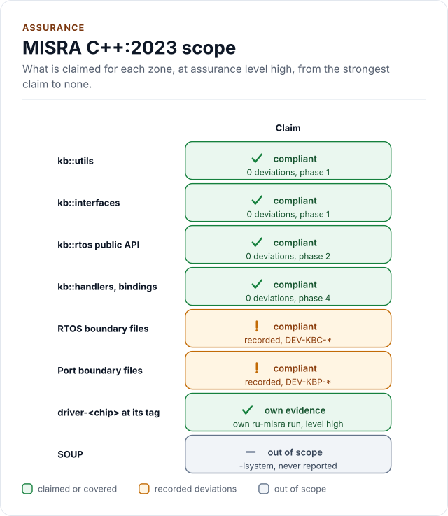

# Assurance

What kb-core claims, at which level, how each claim is verified, and what kb-core is not. Decision:
[ADR-0011](../adr/ADR-0011-assurance-level-high.md). Records: [Assurance records](../assurance/README.md).

## Level and role

- kb-core is at the handbook's level **`high`**, like the drivers.
- **Drivers and handlers are not the safety layer.** A product's safety functions must reach their safe state
  without any driver or handler call succeeding; kb-core provides bounded, documented building blocks (bounded
  waits, health states, liveness) that a safety layer may use as inputs.
- `safety` is a later option per component, by a new decision record, once a MISRA checker accepted for that
  purpose is obtained and a product intends to qualify the component.

## Claim

> kb-core's own code under `components/lib/` complies with MISRA C++:2023 with one recorded library deviation above the
> boundary files (DEV-KBC-004, the `*Ref` adapters in `kb/interfaces/refs.hpp`, ADR-0011 amendment). Boundary
> files comply with the deviations recorded for them. Each MCU port makes the same claim for its own
> folder with its own records. The MCU SDKs, RTOS kernels and vendor HALs are SOUP and outside the claim. Drivers
> are covered by their own release evidence at their pinned tags.

The scan's `paths` are the library code: each part's public headers (`components/lib/<part>/inc`) and the RTOS boundary
files.
Test code (unit, compile-fail and fuzz tests, the host test port in `components/lib/interfaces/host/` and the
`std::thread`
host backend in `host/`) is built with the same flags and analysed by clang-tidy and cppcheck, but is outside the
MISRA claim.

<!-- figure: misra-scope -->
<picture>
  <source media="(prefers-color-scheme: dark)" srcset="../diagrams/misra-scope.dark.svg">
  
</picture>
<!-- /figure -->

## Phases

| Phase | Scope | Target | Gate |
| --- | --- | --- | --- |
| P1 (M1, M3) | `components/lib/utils`, `components/lib/interfaces` contracts, the host port | Zero findings, zero repository deviations | `ru-misra` at `high`, host and Cortex-M, from the first commit of each part |
| P2 (M2) | `components/lib/rtos` public API, `none` backend | Zero deviations | Same |
| P3 (M2, M4) | `components/lib/rtos/backends/freertos/*_boundary.cpp`, `components/ports/esp32/src/*_boundary.cpp` | Findings only at SDK call sites, each a recorded deviation | Same, plus a second review of every boundary diff |
| P4 (M4, M5) | `components/lib/handlers` bindings and handlers | Zero deviations (driver headers compiled, not reported) | Same |
| P5 (M5) | Compliance matrix for every guideline | Complete per release | Handbook `misra_matrix.py` |

## The boundary-file method

- An SDK or RTOS header is included only by a `.cpp` listed in a `boundary-files.yml`; never by a header. The
  include checker and the symbol lint enforce it.
- SDK include directories are passed with `-isystem`, and the MISRA scan's `paths` lists only kb-core's own
  folders, so findings inside SDK headers are never reported or deviated.
- A boundary file holds only thin typed wrappers in an anonymous namespace: convert kb types to SDK types, call,
  convert the result to `kb::Result` with the vendor code in `detail`. No logic beyond a retry count.
- Each remaining finding at an SDK call site gets one record (`id`, `check: misra/Rule X.Y.Z`, `where`, `reason`,
  `mitigation`, `approved_by`, `date`, `review_by`); a marker in code cites the id; a marker that deviates nothing
  fails the scan.
- Each boundary file has a host test that links it against a fake of the SDK functions it calls (a link seam), so
  the conversion and error mapping are tested without the SDK.

## What is verified how

| Property | Primary | Secondary |
| --- | --- | --- |
| Decidable MISRA rules | CodeQL MISRA C++:2023 pack (pinned in ci-tools) | Preflight `misra_lint.py` (fast, partial) |
| KB-CPP20 profile and handbook source rules | `kokeb-cpp20` CodeQL pack, handbook source check | clang-tidy |
| Undecidable rules (run-time behaviour, dead stores) | Sanitizers, coverage, fuzzing | Review checklist entry in the compliance matrix |
| Recursion, unused code | CodeQL in CI | A call-graph check in preflight |
| Concurrency (both thread models) | ThreadSanitizer on the FreeRTOS POSIX port on the host | Lock-order review; owner-task assertions |
| Contract conformance | `static_assert(Concept<T>)` per port, compile-fail tests | Integration matrix |
| Test strength | Mutation testing with a kill-rate gate | Independent review |
| Platform freedom | Poison build, include checker, symbol lint | CMake DAG check |
