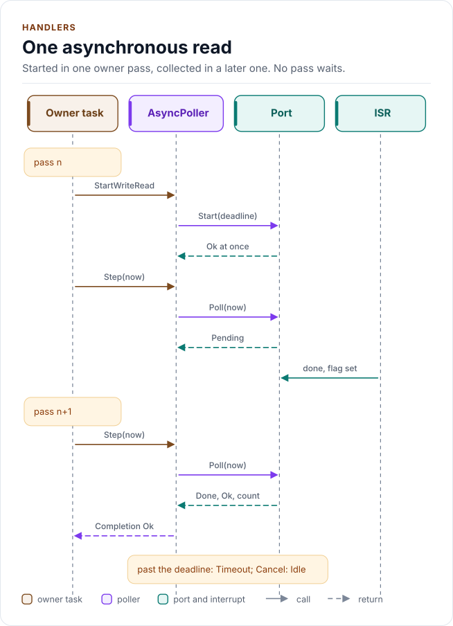
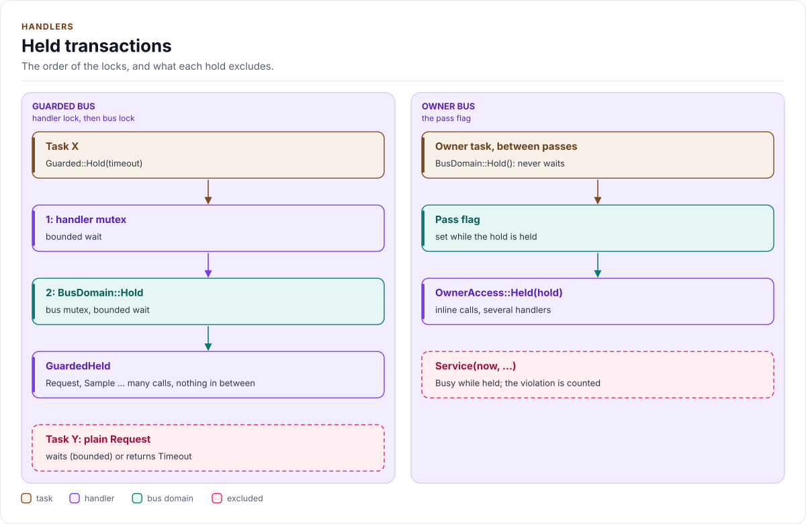

# Bus access: non-blocking reads and held transactions

Decision: [ADR-0016](../adr/ADR-0016-async-bus-and-held-transactions.md). Every contract call is bounded; this page
is about the two cases bounded is not enough for: a hot-path read that must not wait at all, and a sequence of
transfers or calls that must not be interleaved.

## Rules

| Rule | Detail |
| --- | --- |
| Safety paths never wait on a bus | A safety task cuts outputs first and reads only published snapshots (`Latest()`, `Health()`, the liveness verdict) |
| Hot paths never block | A read on the control path is started in one owner pass and collected in a later one (`AsyncPoller`); a poller over a port whose Start() waits does not compile unless it says `AsyncUse::MayBlock` |
| One transfer in flight per port object | `Start...()` returns `Busy` while one is in flight |
| Deadlines bound everything | A transfer not done by its deadline completes as `Timeout`; a completion after the deadline is `Timeout` too |
| Buffers outlive the transfer | `AsyncPoller` owns them; its destructor cancels a transfer in flight |
| Sequences run held | A multi-chunk range or several calls run under one hold: `Guarded::Hold()` or the owner's `BusDomain::Hold()` with `OwnerAccess::Held()` |
| Never hold two buses | Every wait is bounded, so a violation ends in `Timeout`, never a hang |

## The asynchronous contract

`kb/interfaces/async.hpp`: `I2cAsync` (`StartWrite`, `StartWriteRead`, `StartRead`) and `SpiAsync`
(`StartTransfer`) are the synchronous contracts plus `Poll(now)`, `Cancel()` and `kNonBlocking`.

| Call | Returns |
| --- | --- |
| `Start...(..., kb::utils::Deadline)` | `Ok` (started), `Busy`, `InvalidArgument`, `Timeout` (deadline passed), `NotReady`; never waits |
| `Poll(now)` | `AsyncPoll`: `Idle`, `Pending`, or `Done` with `Completion()` as a `kb::Result<std::size_t>`; reported once |
| `Cancel()` | `Ok`; afterwards nothing touches the buffers, a racing completion is dropped, the next Poll() is `Idle` |

`AsyncFromSync<Bus, Clock>` serves the contract from a synchronous port (Start() runs the transfer, the deadline
rules still hold, `kNonBlocking` is false), so a binding builds on every port today and the remaining wait is
visible in its type. What each port adds for a native form is listed in ADR-0016.

<!-- figure: async-poll -->
<picture>
  <source media="(prefers-color-scheme: dark)" srcset="../diagrams/async-poll.dark.svg">
  
</picture>
<!-- /figure -->

### In an owner-task access

```cpp
struct PressureSampler {
  kb::handlers::AsyncPoller<Bus, 4U>& poller;
  kb::handlers::Seqlock<uint16_t>& out;

  [[nodiscard]] bool Service(const kb::handlers::ServiceKey& key, kb::Instant now) noexcept {
    static_cast<void>(key);
    if (!poller.InFlight()) {  // start the next read; returns at once
      static_cast<void>(poller.StartWriteRead(0x48U, kRegister, 2U, now, kb::Microseconds{800U}));
    }
    const kb::iface::AsyncPoll p = poller.Step(now);  // one poll, never a wait
    if (p.Completion().IsOk()) {
      out.Publish(Decode(poller.Received()));
    }
    return true;
  }
};
// The owner task: spi1.Service(now, sampler, other_handlers...) every step.
```

`AsyncPoller` counts starts, refusals, completions by outcome, cancels and the longest start-to-completion time
(`Stats()`).

## Held transactions

`BusDomain::Hold(timeout)` returns a `BusHold`: `[[nodiscard]]`, move-only, made only by the domain. On a guarded
bus it is the bus mutex, taken within `timeout`; on an owner bus it is the service-pass flag, taken at once or not at
all (a hold and a pass exclude each other, and a refused one is counted as a violation). `Bus()` is the bus while
held and null after `Release()`; `Bus()` on a temporary hold does not compile, since the hold would be released
before the bus is used.

| Model | Held calls | Order and waits |
| --- | --- | --- |
| Guarded | `auto held = rom.Hold(timeout);` then `at25040b::Write(held, ...)`, `held.Request(...)`, `held.Sample(...)` | Handler mutex, then bus mutex, as every call; both bounded. Calls on a hold that was not had return `Timeout`, after `Release()` `NotReady` |
| Owner | On the owner task, between passes: `auto bus = spi1.Hold(t); auto a = enc.Held(bus); auto b = rom.Held(bus);` | Never waits. Calls run inline; a hold of another bus type does not compile, of another domain object or released refuses with `NotReady` |

A guarded handler has no `Held(BusHold&)`: taking its handler lock while holding the bus would invert the lock order.

<!-- figure: bus-hold -->
<picture>
  <source media="(prefers-color-scheme: dark)" srcset="../diagrams/bus-hold.dark.svg">
  
</picture>
<!-- /figure -->

What needs it: an at25040b range of several chunks (the integration test writes a record in three parts while
another task writes the same range; the record lands whole), as5047u angle and velocity read as one pair,
ads7952 mode programming followed by its frames, se05x T=1 block chains.

## Tests

| What | Where |
| --- | --- |
| Contract, adapter and fakes (latency, hang, NACK, late completion, cancel race, buffers untouched) | `components/lib/interfaces/tests/test_async.cpp` |
| Poller and an owner pass that never waits | `components/lib/handlers/tests/test_async_poller.cpp` |
| Holds, moves, release, both facades' held calls | `components/lib/handlers/tests/test_hold.cpp` |
| Held calls against plain callers and against the owner's passes, under ThreadSanitizer | `components/lib/handlers/tests/test_threads.cpp` |
| Misuse that does not compile: copy, discard, a temporary's bus, another bus's hold, a guarded `Held`, a blocking hot path | `components/lib/handlers/tests/compile_fail/` |
| at25040b ranges held whole in both models | `tests/integration/at25040b/` |
