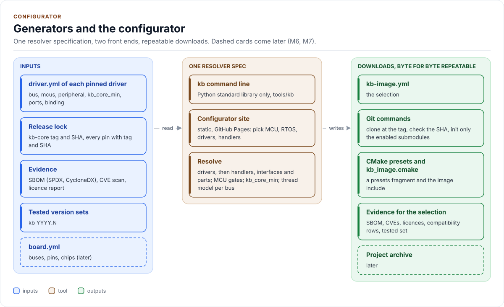

# Configurator

How a user gets exactly the kb-core configuration they need, pinned and with evidence: the image file, the `kb`
command-line tool and the hosted configurator site. Decision:
[ADR-0013](../adr/ADR-0013-hosted-configurator.md). Skeleton page: `configurator/index.html`.

<!-- figure: generator-flow -->
<picture>
  <source media="(prefers-color-scheme: dark)" srcset="../diagrams/generator-flow.dark.svg">
  
</picture>
<!-- /figure -->

## The image

An **image** is the selection one firmware build uses: MCU family and target, port version, RTOS backend, kb-core
version, drivers (each at a catalogued version, by default kb-core's pin) and the thread model of each bus. It is
one file ([schema](assembler.md#image)); the commits come from the catalogue into the lock, never from the image:

```yaml
# kb-image.yml (in the board HAL or product repository)
image: example-board-a
schema: 1
kb_core: {version: 0.4.0}
mcu: {family: esp32, target: esp32s3}
rtos: freertos
drivers: [pf1550, bmp581, {name: tmc9660, version: 0.2.0-rc.1}]
buses:
  i2c0: {model: guarded, devices: [pf1550, bmp581]}
  spi1: {model: owner, devices: [tmc9660]}
```

## The site

A static site on GitHub Pages: no server, no account, no cookies, no analytics, no third-party script at run time.

| Step | What the user does | What the site does |
| --- | --- | --- |
| 1 | Picks MCU family and target | Offers the kb-core versions and ports that support it |
| 2 | Picks the RTOS backend | Checks it against the MCU (ESP-IDF needs FreeRTOS) |
| 3 | Picks a kb-core version or a tested set `kb YYYY.N` | Loads that release's catalogue, lock and evidence |
| 4 | Picks drivers and handlers | Resolves drivers to handlers to interfaces to parts; applies the MCU gates and `kb_core_min` |
| 5 | Declares the thread model of each bus | Refuses a bus with both models, and `kRequiresOwner` chips on a guarded bus |
| 6 | Downloads | `kb-image.yml`, the git commands, the CMake presets fragment, and the evidence |

### Downloads

Every download is byte-for-byte repeatable: sorted keys, no timestamps (the CVE scan date is a separate field),
every component named by version and commit SHA.

```bash
# In the project's git repository: every part as a submodule under external/ at its tag, each commit checked
sh kb-fetch.sh            # external/kb-core, external/drivers/driver-pf1550, ... (no branch, no --recursive)
sh kb-fetch.sh --verify   # in CI: every submodule still at its pinned commit
```

The layout is the same for the CLI and the site ([Assembler and resolver](assembler.md#layout)).

### Evidence

| Evidence | Format | Source |
| --- | --- | --- |
| SBOM | SPDX 2.3 JSON and CycloneDX 1.6 JSON | The release's SBOM, filtered to the selection |
| Known CVEs | A report per component with scan date and database version | Scanned in the release job, re-scanned on a schedule |
| Licences | A table of each component's SPDX licence and copyright holder | The SBOM |
| Compatibility | The catalogue rows of the selection | `catalog/compat.yml` of the release |
| Tested set | The tested version set the selection belongs to and the configurations that passed, or "untested combination" | Tested version sets |

The evidence is produced and signed by kb-core's release job; the site only filters and presents it.

## The `kb` tool

One Python tool in `tools/kb/` ([the kb tool](../kb-tool.md)): `kb catalog build`, `kb resolve` (the lock,
presets, `kb_image.cmake`, the fetch script) and `kb sbom`. The site and the tool implement one resolver
specification ([Assembler and resolver](assembler.md), [ADR-0014](../adr/ADR-0014-kb-core-is-the-assembler.md))
and pass the same golden test vectors (`tests/resolver/vectors/`). `driver.yml` may carry two optional fields the
catalogue reads: `license` (else the `LICENSE` file decides) and `requires_owner` (`kRequiresOwner`).

## Phases

| Phase | When | Delivers |
| --- | --- | --- |
| P0 | Now | Skeleton page in `configurator/`, this design, ADR-0013 |
| P1 | M4 | Catalogue as JSON, `kb-image.yml`, git commands, presets; `kb image check` in CI |
| P2 | M6 | SBOM, CVE results, licence report and tested sets per release and per selection |
| P3 | M7 | Project archive from `kb-app-template`, `board.yml` pin tables; move to `kb-configurator` |
