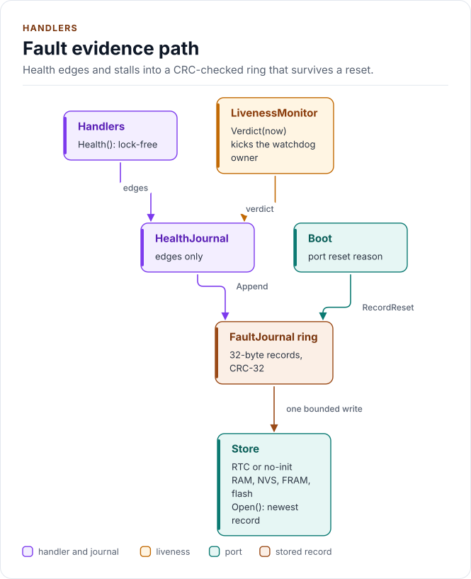

# Fault evidence: liveness and the fault journal

Fault evidence must survive the reset the fault causes, and a watchdog must only be kicked when the work, not just a
loop, is alive. Two pieces serve that: the liveness verdict (`kb::handlers::LivenessMonitor`) and the fault journal
(`kb::utils::FaultJournal<Store, Slots>`), joined by `kb::handlers::HealthJournal` on the supervisor task.

<!-- figure: fault-journal -->
<picture>
  <source media="(prefers-color-scheme: dark)" srcset="../diagrams/fault-journal.dark.svg">
  
</picture>
<!-- /figure -->

## Liveness

Each handler beats when it is serviced or called (`LivenessBeat`). A monitor watches up to 32 beats, each with its
own window (the stall budget). A context that stops on purpose declares it: `Park()` makes a beat never stale, and
its window starts again when it beats or `Resume()`s. `Verdict(now)` gives the stale and parked bits and `kick`, true
only when at least one beat is watched and none is stale; the watchdog owner (in the port) kicks only then. The
monitor never calls a handler and never blocks.

## The fault journal

| Property | How |
| --- | --- |
| Fixed size, no allocation | `Slots` records of 32 bytes in the store (2 to 4096); the journal object holds four counters |
| Integrity | Magic, format version, CRC-32 (`Crc32Ieee`) over 28 bytes |
| Torn write | A reset in the middle of a write leaves a slot whose CRC fails: `Open()` counts it as torn and skips it; the next append overwrites it |
| Wrap-around | Appends go to the slot after the newest; the oldest is overwritten; sequences wrap and compare modulo 2^32 |
| Bounded write | `Append()` is one store write of 32 bytes, no scan |
| After a reset | `Open()` reads each slot once and continues after the newest valid sequence |
| Reset reason | `RecordReset(reason, port_code, now)` at boot: `ResetReason` in `value`, the port's raw code in `detail` |

Record layout (little-endian): magic `0x4A4B` (bytes 0-1), version 1 (2), kind (3), sequence (4-7), time in
microseconds (8-15), source (16-17), `kb::Status` (18), reserved 0 (19), detail (20-23), value (24-27), CRC-32 of bytes
0-27 (28-31). `ParseRecord()` reports `Empty` (no magic: never written or erased), `CrcMismatch` (torn or corrupt) or
`Unsupported` (another version, a reserved byte set, an unknown kind or status).

### The store

A `JournalStore` has `Capacity()`, `Read(offset, span)` and `Write(offset, span)`, each bounded. kb-core ships
`RamJournalStore<Bytes>` (host tests, and ports that place it in RAM kept across a reset). Ports add flash, NVS,
FRAM or backup-register stores; a flash store hides erase units behind `Write()` or gives each slot its own write
unit (ADR-0015 lists what each port adds).

```cpp
kb::utils::RamJournalStore<16U * kb::utils::kFaultRecordBytes> store{};  // the port places it in no-init RAM
kb::utils::FaultJournal<decltype(store), 16U> journal{store};
static_cast<void>(journal.Open());
static_cast<void>(journal.RecordReset(port::ResetReason(), port::ResetCode(), kb::rtos::Now()));
const auto last_fault = journal.FindNewest(kb::utils::RecordKind::Fault);  // the evidence of the last run
```

## The health path

`HealthJournal<Sink, N>` writes edges only: a handler entering `Faulted` (`Fault`: its last status, the driver's code,
failures in a row), a faulted handler serving again (`Health`), and a liveness watch going stale (`Stall`: the newly
stale bits). A refused record is retried at the next observation. One context: the supervisor task that reads every
handler's `Health()` and the verdict.

```cpp
kb::handlers::HealthJournal<decltype(journal), 4U> evidence{journal};
// supervisor step:
static_cast<void>(evidence.Observe(0U, kImuId, imu.Health(), now));
const kb::handlers::LivenessVerdict v = monitor.Verdict(now);
static_cast<void>(evidence.ObserveLiveness(v, now));
if (v.kick) { port::KickWatchdog(); }
```

## Tests

| What | Where |
| --- | --- |
| Record layout against a golden record, every parse refusal, store bounds, scans after a reset, torn writes, sequence wrap, reads by age, the reset record | `components/lib/utils/tests/test_fault_journal.cpp` |
| Parsing and scanning arbitrary bytes (fuzz) | `components/lib/utils/fuzz/fuzz_utils_journal.cpp` |
| Health and liveness edges, retries, records after a reset | `components/lib/handlers/tests/test_health_journal.cpp` |
| Parked beats and the verdict | `components/lib/handlers/tests/test_liveness.cpp` |
