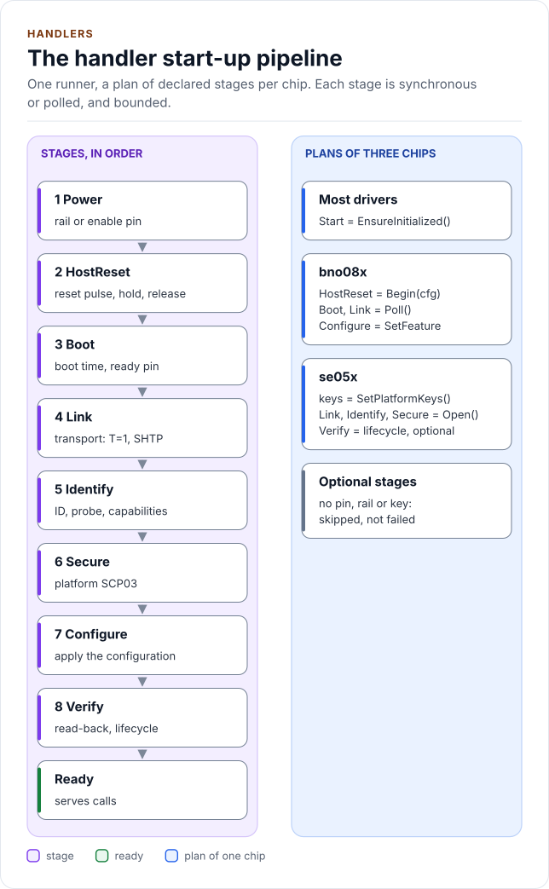
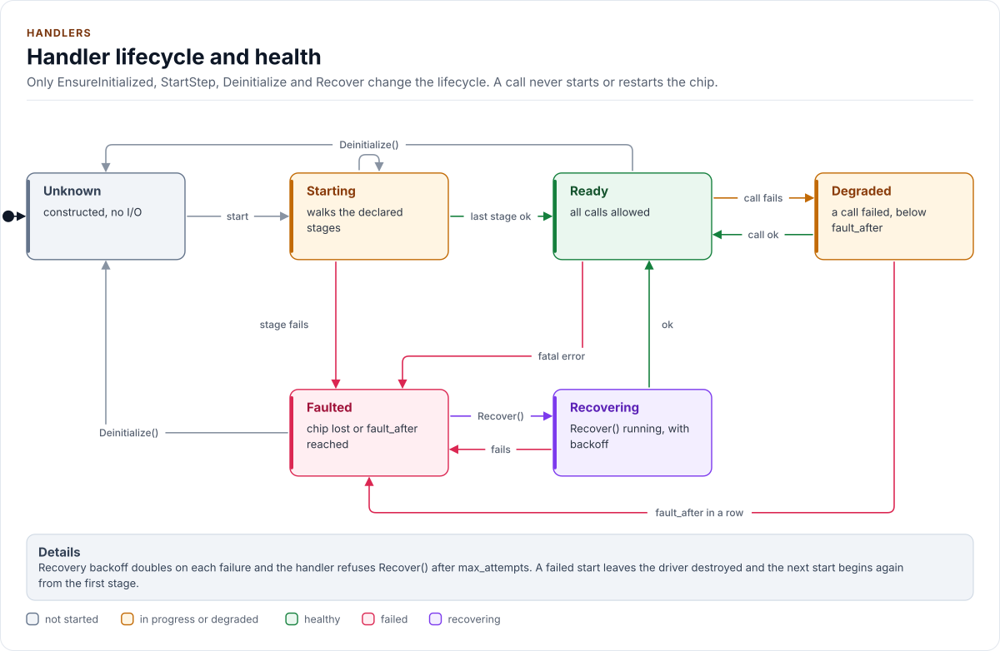
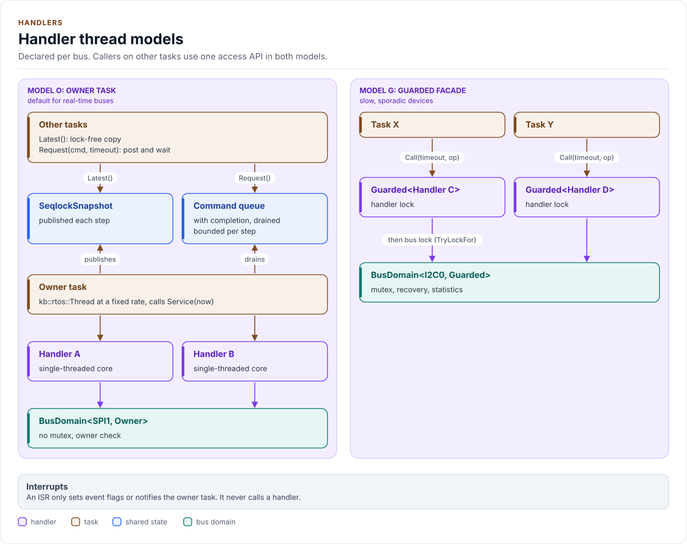

# Handlers

What a handler is, how it starts, how it stays healthy, and how several tasks use it. Decisions:
[ADR-0009](../adr/ADR-0009-handler-thread-models.md) (thread models) and
[ADR-0010](../adr/ADR-0010-handler-startup-pipeline.md) (start-up pipeline). Status: implemented in
`components/lib/handlers/` (the core in `common/`, one binding per driver in `bindings/`); every handler has its page
under
[Handlers](../handlers/index.md).

## What a handler is

A handler binds **one driver instance** to **one device on a bus domain**, **one configuration** and **a health
record**, and exposes a typed API that returns `kb::Result`. It is the only object a HAL manager talks to for that
chip.

```text
Handler<Chip>   (kb::handlers::HandlerCore<Derived, Driver>, CRTP, ADR-0006)
├── Binding          satisfies the driver's port over kb contracts (hook bases or hand-written)
├── std::optional<Driver>   emplaced by the start-up pipeline, destroyed on failure or Deinitialize()
├── StartupPlan      constexpr list of declared stages (ADR-0010)
├── Config           driver config + handler config (address, deadlines, retry policy, health thresholds)
├── Health           state, consecutive failures, last error + detail + time, counters (seqlock snapshot)
└── Diagnostics      common header first, then chip counters
```

The core is **single-threaded**: it holds no lock. Thread safety comes from the access facade its bus declares
([thread models](#thread-models)).

Rules:

- Construction stores references, does no I/O, touches no RTOS object and cannot fail; a handler works as a
  static object.
- `EnsureInitialized()` is the one start (handbook ADR-0021). Reads and writes never start or restart the chip:
  before the start has succeeded they return `NotInitialized` and send nothing.
- No board value inside kb-core: addresses, pins, deadlines and thresholds arrive in `Config` from the HAL.
- A driver is never changed to suit a handler; the binding adapts.

## Start-up pipeline

`EnsureInitialized()` runs the chip's start-up plan: a `constexpr` list of declared stages, executed by one runner
in `HandlerCore`. A plan lists only the stage kinds its chip needs, in a fixed order; one driver call may cover
several kinds.

<!-- figure: handler-startup -->
<picture>
  <source media="(prefers-color-scheme: dark)" srcset="../diagrams/handler-startup.dark.svg">
  
</picture>
<!-- /figure -->

| Kind | Does |
| --- | --- |
| `Power` | Enable a rail or an enable pin, wait its settle time |
| `HostReset` | Host-driven reset: pulse, hold, release |
| `Boot` | Wait the boot time or a ready condition (ready pin, advertisement) |
| `Link` | Bring up a transport session (T=1, SHTP) |
| `Identify` | Read the ID, select an applet, probe capabilities |
| `Secure` | Open a secure channel needed for normal use (platform SCP03) |
| `Configure` | Apply the configuration |
| `Verify` | Read back, check the lifecycle state |

Each stage declares the driver call, **sync** (one call) or **polled** (repeated until done), its deadline (a
`Config` field), and whether it is optional (skipped when the HAL supplies no pin, rail or key for it). The runner
keeps a `StartupReport`: the stage reached, the `kb::Status`, the driver's own error in `detail`, and the time
each stage took. On a failure it runs the plan's abort call, destroys the driver and stays `Constructed`, so the
next `EnsureInitialized()` starts from the first stage again.

`StartStep(now)` runs at most one step of the current stage and returns `Pending`, `Ok` or the failure; an owner
task calls it from `Service(now)` and never blocks. `EnsureInitialized()` is the loop over `StartStep()`, waiting
with `kb::rtos::SleepFor` between polls and bounded by the sum of the stage deadlines.

### The plans

| Chip | Stages | Calls |
| --- | --- | --- |
| Most drivers (21) | `Identify + Configure`; optional `Power`, `HostReset` | `driver.EnsureInitialized()` (sync); the optional stages only when the HAL supplies the pin and the driver does not drive it itself |
| bno08x | `HostReset` | `Begin(cfg)` (sync): validates, brings the port up, pulses NRST when the port has `SetReset` |
| | `Boot + Link` | `Poll(now)` until `Ready()` (polled): reset wait, advertisement, initialise handshake; deadline from `startup_timeout_ms`; fails when the driver enters `Faulted` |
| | `Configure` | one `SetFeature` per configured sensor, polled until each `OpDone`; deadline from `op_timeout_ms` |
| se05x | `Link + Identify + Secure` | `SetPlatformKeys()` first when the HAL supplies key handles (no I/O, never keys), then `Open()` (sync, every wait bounded by the link): link, card data, applet select, feature bits, capability probes, lifecycle state, platform SCP03 when required; skipped when `IsOpen()` |
| | `Verify` (optional) | lifecycle state against what the HAL expects |

A plan lists each kind once, in kind order (checked at compile time), so two calls that serve kinds of one stage
are one stage: se05x sets its key handles at the start of its `Open()` stage, and bno08x without NRST declares
`Link` = `Begin(cfg)`, then `Identify` = `Poll(now)` until `Ready()`, then `Configure`.

What stays outside the pipeline, and the two driver-level waivers to handbook ADR-0021 (W-01 bno08x
`Begin`/`Poll`, W-02 se05x `Open`/`Close`), are in [ADR-0010](../adr/ADR-0010-handler-startup-pipeline.md). No
handler-level waiver is needed. se05x applet sessions (UserID, AESKey, ECKey) are per transaction, opened by
handler calls inside a held bus transaction.

## Lifecycle and health

<!-- figure: handler-health -->
<picture>
  <source media="(prefers-color-scheme: dark)" srcset="../diagrams/handler-health.dark.svg">
  
</picture>
<!-- /figure -->

- Health states: `Unknown` (not started); `Starting`; `Ready`; `Degraded` (failures below `fault_after`); `Faulted`
  (threshold reached, a start failed, or the binding calls the error fatal: the chip reset or lost its state);
  `Recovering`. When `max_attempts` recoveries in a row failed, `Recover()` refuses with `Fault` and the handler
  stays `Faulted`: the HAL decides on its safe state. A caller's own mistake (`InvalidArgument`) is recorded but
  not counted against the chip.
- `Recover()` is explicit and never triggered by a read. It runs on the owner task (model O) or under the guarded
  locks (model G), at the HAL's chosen time, with backoff: bus recovery when the failure was a bus failure, then
  the plan's recovery (generic: `Deinitialize()` and the plan; se05x: the driver's `Recover()` ladder before
  `Close()` and the plan; bno08x: a hub restart is a `Reset` event and health `Degraded`, the plan runs again only
  after `Faulted`).
- `Health()` is lock-free to read (a seqlock snapshot), so a supervisor can poll every handler without contending
  with its users.
- A handler is not a safety function: a safety layer must reach its safe state without a handler call succeeding
  ([ADR-0011](../adr/ADR-0011-assurance-level-high.md)).

## Thread models

Each bus declares one model; the handler's access facade must match it (compile error otherwise).

<!-- figure: handler-threading -->
<picture>
  <source media="(prefers-color-scheme: dark)" srcset="../diagrams/handler-threading.dark.svg">
  
</picture>
<!-- /figure -->

| | Model O, owner task | Model G, guarded facade |
| --- | --- | --- |
| For | High-rate or timing-critical devices; buses whose devices one loop serves; chips that need continuous servicing (bno08x) | Slow, sporadic devices used from several tasks (EEPROM, expander, power IC) |
| Default | Yes, for real-time buses | No |
| Bus type | `BusDomain<Bus, ThreadModel::Owner>`: no mutex; debug-build owner check | `BusDomain<Bus, ThreadModel::Guarded>`: mutex, recovery, statistics |
| Who touches the handler | Only the owner task, through `Service(now)` | Only `Guarded<H>`, which owns it |
| Other tasks | `OwnerAccess<H>`: `Latest()` (lock-free snapshot with sequence and age), `Request(cmd, timeout)` (bounded queue, waits for the owner's completion) | `Guarded<H>::Call(timeout, op, args...)`: handler lock, then bus lock, both bounded `TryLockFor`; `Timeout` and nothing sent if either is not had in time |
| Locks | None on the bus | Fixed order handler then bus; never held across another handler or a user callback |
| Start-up | `StartStep(now)` from `Service` | `EnsureInitialized()` under the guarded locks, bounded |

Both facades offer the same typed operations to callers, so HAL managers and applications do not change when a bus
changes model. Interrupts never call handlers: an ISR sets an event flag or notifies the owner task. A chip that
must be serviced continuously declares `kRequiresOwner` in its binding and cannot be wrapped in `Guarded<H>`.

A sequence of calls that must not be interleaved (an EEPROM range of several chunks, a pair of reads) runs held:
`Guarded<H>::Hold(timeout)` keeps both locks in the same order, and on an owner bus the owner task takes
`BusDomain::Hold()` between passes and calls through `OwnerAccess<H>::Held(hold)`. A hot-path read that must not
wait at all uses the asynchronous contract through `AsyncPoller`. Both are on [Bus access](bus-access.md)
(ADR-0016); the liveness verdict and the fault journal are on [Fault evidence](fault-journal.md).

## Uniform API across driver shapes

| Driver shape | Handler mapping |
| --- | --- |
| `EnsureInitialized()` / `Deinitialize()` (21 drivers) | direct, through the generic plan |
| bno08x `Begin(config)`, `Poll(now)`, events, asynchronous `OpId` | the plan above; `Service(now)` calls `Poll` and drains events into a bounded queue; typed calls complete when the `OpDone` arrives or the timeout expires |
| se05x `Open()` / `Close()` / `Recover()`, transactions | the plan above; `Deinitialize()` = `Close()`; `Recover()` drives the driver's ladder first; transactions run inside a `BusHold` |

## How applications use kb-core

```cpp
// Application code: only the HAL facade, kb::utils and kb::rtos.
class PressureLoop final : public kb::rtos::Thread<PressureLoop, 4096U> {
 public:
  explicit PressureLoop(board::Hal& hal) noexcept : hal_(hal) {}
  kb::Status Setup() noexcept { return hal_.Pressure().EnsureStarted(); }
  void Step() noexcept {
    const kb::Result<kb::Pascal> p = hal_.Pressure().Latest();  // manager -> owner snapshot
    if (p) { filter_.Push(p.value); }
  }
 private:
  board::Hal& hal_;
  kb::utils::MovingAverage<kb::Pascal, 8U> filter_{};
};
```

- The composition root (the board facade) is one object, built statically, started explicitly from the first task
  in a fixed order; applications receive it by reference, never through a global `Instance()`.
- Applications use `kb::utils` and `kb::rtos` directly; they never include `kb/interfaces` or `kb/handlers`
  (include checker and symbol lint).
- HAL-free application logic (control laws, protocol state machines) lives in libraries that link only
  `kb::utils` and are tested on the host with recorded-data replay.

The sketch is illustrative; the compiled version arrives in `tests/docs/` with the first handler.
