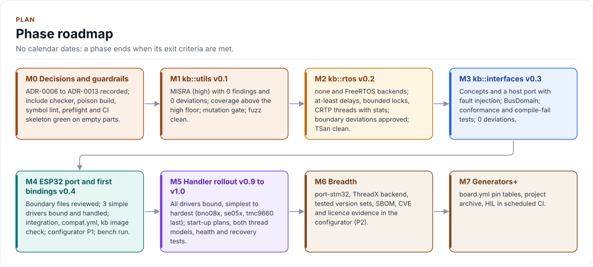

# Plan

The design of kb-core in one page: what it is, the decisions taken, the phases and their exit criteria, and the
risks. Detail is on the design pages ([handlers](handlers.md), [MCU ports and repositories](ports.md),
[assurance](assurance.md), [configurator](configurator.md), [design rules](rules.md)) and in the
[decision records](../adr/README.md).

## Summary

1. **Shape.** One repository, four parts (`kb::utils`, `kb::rtos`, `kb::interfaces`, `kb::handlers`), one version,
   drivers as submodules pinned to release or release-candidate tags. The board HAL sits above; applications use
   the HAL, `kb::utils` and `kb::rtos` only ([architecture](../architecture.md)).
2. **Contracts.** C++20 concepts only, no virtual functions; a short register of CRTP bases that carry real shared
   behaviour; run-time choice through type-erased `*Ref` values ([ADR-0006](../adr/ADR-0006-concepts-only.md)).
3. **MCU ports.** A separate layer from the first commit: `components/ports/esp32/` is its own CMake project inside
   kb-core
   until the contracts settle, then `kokeb-labs-drivers/port-esp32` ([ADR-0007](../adr/ADR-0007-mcu-ports-isolated.md),
   [ADR-0008](../adr/ADR-0008-repository-naming.md)). RTOS backends and the host test port stay in kb-core.
4. **Handlers.** One driver, one bus-domain device, one configuration, a health record. A single-threaded core with
   one of two access facades declared per bus: an owner task with snapshots (default for real-time buses) or a
   lock-guarded facade ([ADR-0009](../adr/ADR-0009-handler-thread-models.md)). Start-up is a plan of declared
   stages that also fits bno08x and se05x ([ADR-0010](../adr/ADR-0010-handler-startup-pipeline.md)).
5. **Assurance.** Level `high`: CodeQL MISRA C++:2023 plus the compliance matrix; zero repository deviations above
   the boundary files. Drivers and handlers are not the safety layer; `safety` is a later option
   ([ADR-0011](../adr/ADR-0011-assurance-level-high.md)).
6. **Releases.** Each release records its own SHA and every pin in a release lock, with SBOM, CVE scan and
   licence report ([ADR-0012](../adr/ADR-0012-pins-and-release-lock.md)).
7. **Configurator.** A static site (GitHub Pages) to pick MCU, RTOS, drivers and handlers and download a
   repeatable, pinned project with its evidence ([ADR-0013](../adr/ADR-0013-hosted-configurator.md)).

## Decisions

| # | Decision | Taken | Record |
| --- | --- | --- | --- |
| D1 | Interface style | C++20 concepts only; bases only with a recorded reason | [ADR-0006](../adr/ADR-0006-concepts-only.md) |
| D2 | MCU port location | `components/ports/<mcu>/` isolated in kb-core, own CMake project; own repositories later | [ADR-0007](../adr/ADR-0007-mcu-ports-isolated.md) |
| D2a | Repository names | `kb-core`, `port-<family>` (in `kokeb-labs-drivers`), `kb-board-<board>`, `kb-configurator`, ... | [ADR-0008](../adr/ADR-0008-repository-naming.md) |
| D3 | Handler thread models | Both, declared per bus; owner task default for real-time buses; guarded facade | [ADR-0009](../adr/ADR-0009-handler-thread-models.md) |
| D4 | bno08x and se05x start-up | Declared stages in one pipeline; waivers only at the driver API | [ADR-0010](../adr/ADR-0010-handler-startup-pipeline.md) |
| D5 | Assurance level | `high`; drivers and handlers are not the safety layer; `safety` later | [ADR-0011](../adr/ADR-0011-assurance-level-high.md) |
| D6 | MISRA checker | CodeQL pack plus compliance matrix; a commercial checker only with `safety` | [ADR-0011](../adr/ADR-0011-assurance-level-high.md) |
| D7 | Pins | Release or rc tags only, never a branch; release lock with its own SHA | [ADR-0012](../adr/ADR-0012-pins-and-release-lock.md) |
| D8 | Generators | Catalogue, image check and presets at M4; hosted configurator with evidence | [ADR-0013](../adr/ADR-0013-hosted-configurator.md) |
| D9 | Assembler | kb-core = own libraries + a manifest and lock of pinned parts; one resolver for CLI and site | [ADR-0014](../adr/ADR-0014-kb-core-is-the-assembler.md) |

## Phases

Each phase ends on its exit criteria, not a date.

<!-- figure: roadmap -->
<picture>
  <source media="(prefers-color-scheme: dark)" srcset="../diagrams/roadmap.dark.svg">
  
</picture>
<!-- /figure -->

| Phase | Delivers | Exit criteria |
| --- | --- | --- |
| M0 Decisions and guardrails | ADR-0006 to ADR-0013; include checker, CMake DAG check, poison build, symbol lint, preflight, CI callers | Layering fixtures fail and pass as designed; CI green on empty parts |
| M1 `kb::utils` v0.1.0 | Status/Result, units and wrap-safe elapsed time, containers, CRCs, numerics, seqlock, state machine | MISRA (`high`) 0 findings, 0 deviations, host and Cortex-M; coverage goal 100 % branch on utils; mutation gate; fuzz clean; independent review |
| M2 `kb::rtos` v0.2.0 | API, `none` and FreeRTOS (static only) backends, CRTP `Thread`, `Liveness` | At-least delay and bounded-lock tests; FreeRTOS POSIX host tests under TSan; boundary deviations approved |
| M3 `kb::interfaces` v0.3.0 | Concepts, `*Ref` where needed, host port with fault injection, `BusDomain`, `BusHold` | Conformance and compile-fail tests; 0 deviations; contracts reviewed against all 23 driver ports |
| M4 ESP32 port and first bindings v0.4.0 | `components/ports/esp32`, bindings and handlers for three simple drivers, integration matrix, `compat.yml`, `kb image check`, configurator P1 | Boundary files reviewed; integration green; a bench run recorded; port extraction decided |
| M5 Handler rollout v0.9 to v1.0.0 | Every driver simplest to hardest (bno08x, se05x and tmc9660 last), start-up plans, both thread models, health and recovery, async interface form | Every handler's host tests; a board HAL consumes an rc; compliance matrix complete; independent review per part |
| M6 Breadth | `port-stm32`, ThreadX backend (landed first, ADR-0015), tested version sets, configurator P2 (SBOM, CVE, licences) | STM32 port passes the same conformance suite; a version set published with its evidence |
| M7 Generators+ | `board.yml` pin tables, project archive, scheduled bench runs | One board HAL generated end to end |

## Risks

| Risk | Likelihood | Effect | Mitigation |
| --- | --- | --- | --- |
| Handler rollout for 23 drivers takes longer than everything before it | High | v1.0 slips | Hook bases first; before v1.0 bind only what a board HAL needs |
| Handbook and kb-core disagree (handbook ADR-0013 layout, ADR-0016 boundaries, `handler.md` start-up sentence) | Medium | Failed checks, rework | Amend the handbook in M0 (see [open items](#open-items)) |
| A run-time choice is needed where no `*Ref` exists | Medium | Template bloat or a late API change | Add the `*Ref` per contract when the first HAL needs it; reviewed like any contract change |
| Template lint gaps waste CI runs | High | CI minutes | Fix in the template before M1; preflight before every push |
| Contract churn after the port is extracted | Medium | Two-repository pull requests | Extract only at M4 exit |
| Solo maintainer: independent review hard to staff | High | Process gap | A separate independent review pass plus a recorded owner sign-off per part |
| Static-initialisation and ISR-mask hazards on target | Medium | Boot wedge | Constructors never touch the RTOS or hardware; a target smoke test that constructs every kb type statically |

## Open items

| Item | Who |
| --- | --- |
| Amend handbook ADR-0013 (layout), ADR-0016 (boundaries 1 and 3), `handler.md` (no start inside a method), `threading-and-timing.md` (typed `SleepFor`) | Owner, handbook pull request |
| Record waivers W-01 and W-02 in driver-bno08x and driver-se05x | Owner, driver pull requests |
| A read token for private driver repositories (pin hygiene) | Owner |
| Whether a final kb-core release may keep an rc pin (today: allowed, warned) | Owner |
| Price a commercial MISRA C++:2023 checker for a later `safety` option | Owner |
| Create `port-esp32`, `kb-configurator` and the other repositories when their phase arrives | Owner |
