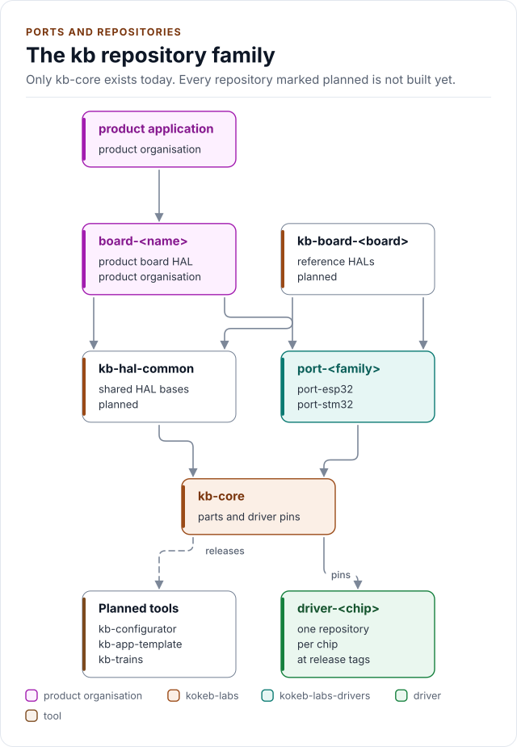

# MCU ports and repositories

Where the MCU and board code lives, how the ESP32 port is isolated so it can move out, and the names of the
repositories around kb-core. Decisions: [ADR-0007](../adr/ADR-0007-mcu-ports-isolated.md) and
[ADR-0008](../adr/ADR-0008-repository-naming.md).

## Three kinds of platform code

| Piece | Contents | Where |
| --- | --- | --- |
| Board | Pin map, bus table and thread model per bus, chip list, rails, start-up order, board managers | The board HAL, outside kb-core; pin tables generated from `board.yml` |
| MCU family port | Implementations of the contracts over one SDK, the monotonic clock, busy-wait, watchdog, reset reason, the SDK boundary files | `components/ports/<mcu>/` in kb-core now, `port-<family>` later |
| RTOS backends | `none`, `freertos` (portable API only), `threadx` (ADR-0015) | Inside kb-core, `components/lib/rtos/backends/<rtos>/`: the RTOS API does not depend on the MCU |
| Start-up code | Vector table, clocks, linker scripts, SDK configuration | The product or board repository; kb-core ships only reference `sdkconfig.defaults` fragments |

The host port (`components/lib/interfaces/host/`) is platform-free test doubles with fault injection; it stays in
kb-core
because every test needs it.

## The ESP32 port, isolated

```text
components/ports/esp32/
├── CMakeLists.txt     project(kb_port_esp32): find_package(kb ...) off target, its own component under ESP-IDF
├── README.md
├── inc/kb/port/esp32/ public headers (namespace kb::port::esp32), no SDK type in a signature
├── src/               the boundary .cpp files, the only files that include ESP-IDF headers
├── deviations/        boundary-files.yml and deviations.yml of this port (DEV-KBP-ESP32-NNN)
└── examples/          ESP-IDF applications, built in the port's own CI job
```

- It sees kb-core only through the installed package or the ESP-IDF component `kb`: never a kb-core source path,
  a private header or a CMake variable of kb-core's build.
- kb-core's CMake never adds an MCU port (`components/ports/host/`, the std::thread RTOS backend, is the host port and
  is built in kb-core's project); the include checker refuses includes across the seam in both directions
  (LAY-010, LAY-011).
- It has its own CI caller (`ci-esp32.yml`), its own SOUP rows and its own deviation records.
- At M4 exit it moves with its history to `port-esp32`; STM32 starts directly as `port-stm32`.

| ESP32 contract | Implementation (planned) |
| --- | --- |
| `I2cBus`, `I2cTransactional` | `kb::port::esp32::I2cController`, `I2cDevice` (ESP-IDF 5.5 `i2c_master`) |
| `SpiDevice` | `SpiMasterDevice` |
| `UartPort` | `Uart` (RS-485 direction pin optional) |
| `GpioOutput`, `GpioInput` | `Gpio` |
| `AdcChannel` | `AdcOneshot` |
| `CanBus` | `Twai` |
| `PulseTx` | `RmtTx` |
| `MonotonicClock`, `BusyWait` | `Clock` (`esp_timer`), `BusyWait` (ROM delay) |

## Repository family

<!-- figure: repo-family -->
<picture>
  <source media="(prefers-color-scheme: dark)" srcset="../diagrams/repo-family.dark.svg">
  
</picture>
<!-- /figure -->

| Repository | Holds | Exists |
| --- | --- | --- |
| `kb-core` | utils, rtos, interfaces, handlers, driver pins, catalogue | Yes (this repository) |
| `port-<family>` (in `kokeb-labs-drivers`) | One MCU family port (`port-esp32`, `port-stm32`), brandless | Planned (M4, M6) |
| `kb-hal-common` | Shared HAL bases | Planned |
| `kb-board-<board>` | Reference board HALs for public development boards | Planned |
| `kb-configurator` | The hosted configurator | Planned; skeleton in `configurator/` |
| `kb-app-template` | The starter project the configurator fills | Planned (M7) |
| `kb-trains` | Tested version sets, only if they outgrow the configurator | Optional |
| `driver-<chip>` (in `kokeb-labs-drivers`) | Brand-free chip drivers | Yes |
| `board-<name>` (in a product organisation) | A product's own board HAL, no `kb-` prefix | Product's choice |

Naming rules and the namespace, target, package and include root each name implies:
[ADR-0008](../adr/ADR-0008-repository-naming.md).
