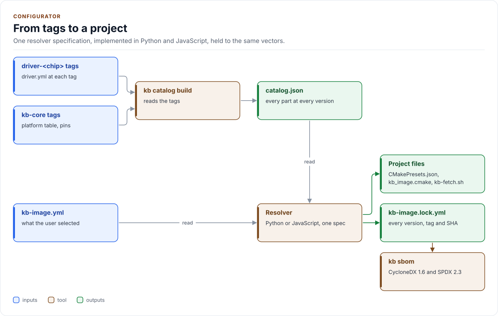
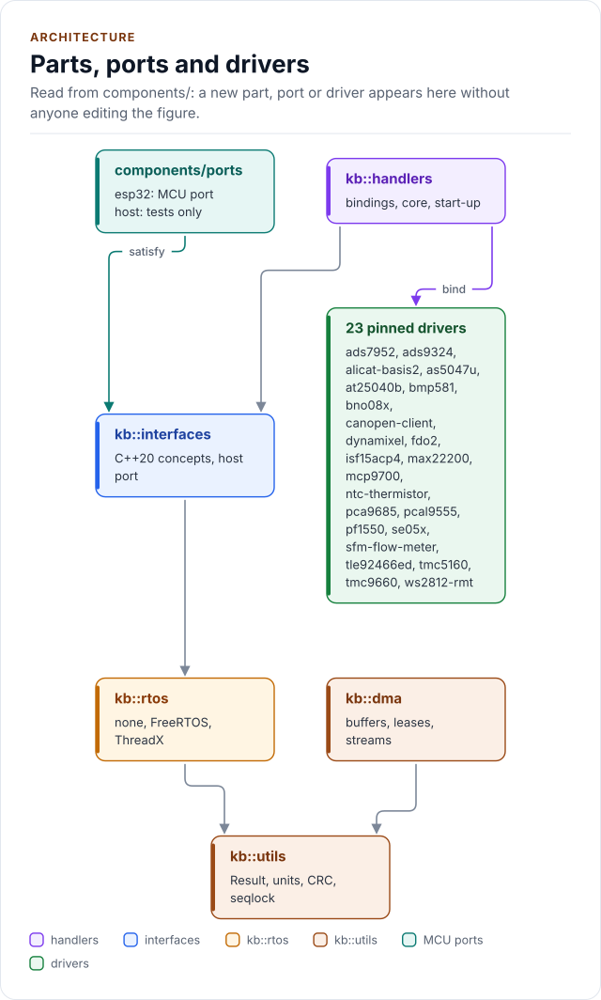
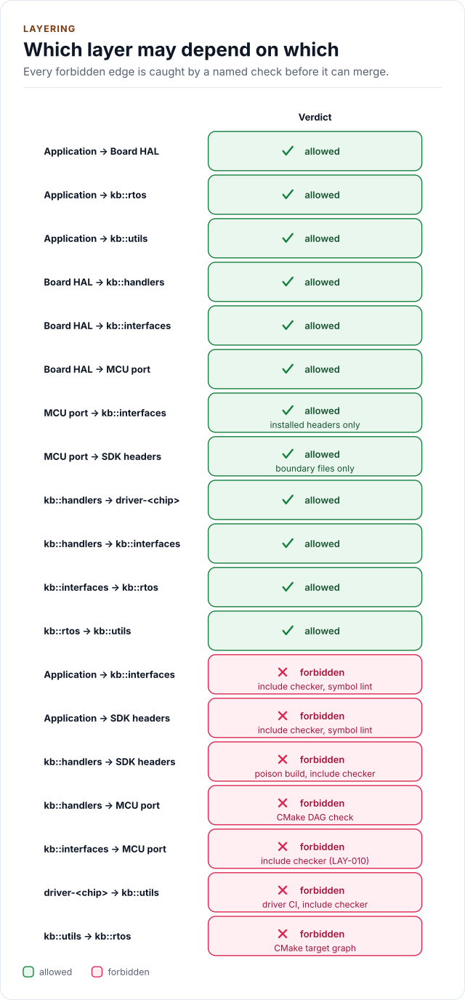
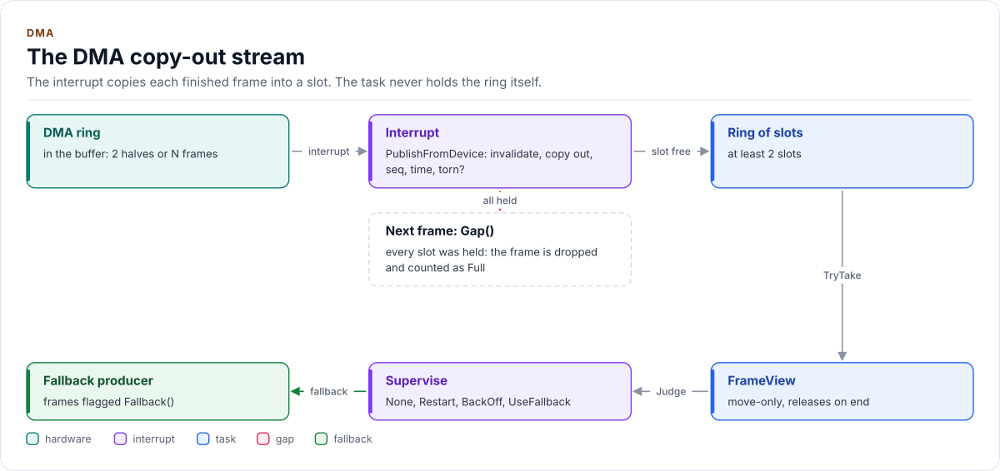
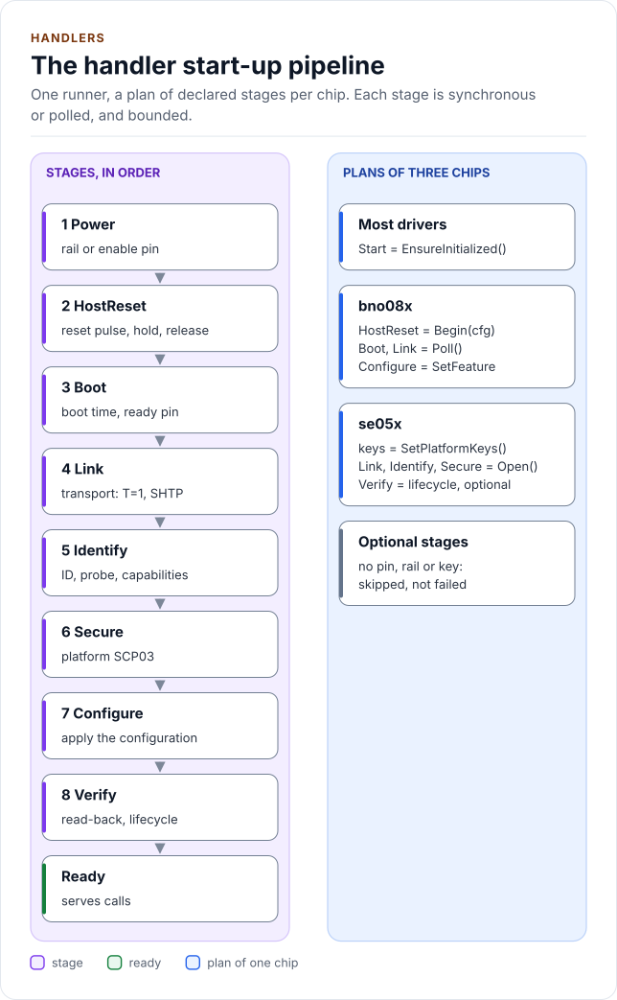
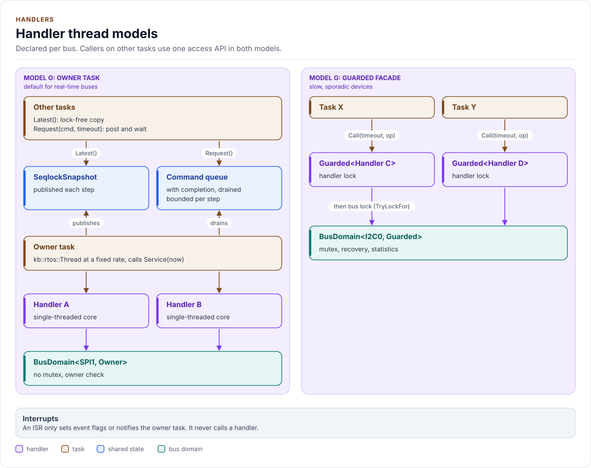
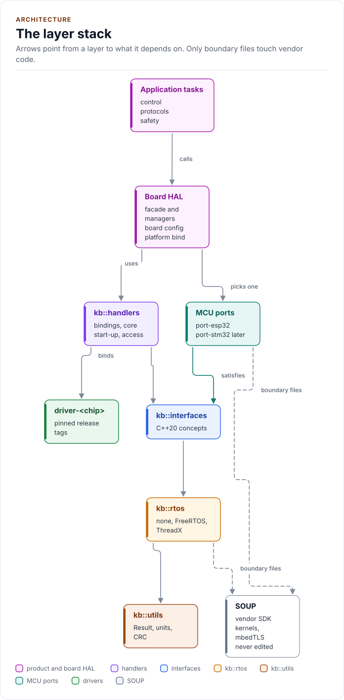
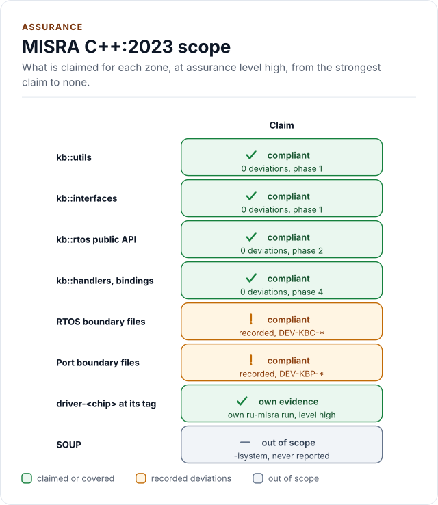

# Figures

<!-- Written by kokeb-docs figures from docs/diagrams/figures/*.py. Do not edit by hand. -->

Every figure on this site is drawn by a Python module from facts extracted from the code, so it is rebuilt,
not redrawn, when the code changes. CI runs `kokeb-docs figures --check` and fails when a
committed figure no longer matches the code. Each figure below lists the files it is drawn from.

## From tags to a project

<!-- figure: assembler-flow -->
<picture>
  <source media="(prefers-color-scheme: dark)" srcset="assembler-flow.dark.svg">
  
</picture>
<!-- /figure -->

Hardware description: [`docs/model/assembler-flow.graph.yml`](../model/assembler-flow.graph.yml)

Drawn from:

- [`docs/model/assembler-flow.graph.yml`](../model/assembler-flow.graph.yml)

## One asynchronous read

<!-- figure: async-poll -->
<picture>
  <source media="(prefers-color-scheme: dark)" srcset="async-poll.dark.svg">
  
</picture>
<!-- /figure -->

Hardware description: [`docs/model/async-poll.seq.yml`](../model/async-poll.seq.yml)

Drawn from:

- [`docs/model/async-poll.seq.yml`](../model/async-poll.seq.yml)

## Held transactions

<!-- figure: bus-hold -->
<picture>
  <source media="(prefers-color-scheme: dark)" srcset="bus-hold.dark.svg">
  
</picture>
<!-- /figure -->

Hardware description: [`docs/model/bus-hold.graph.yml`](../model/bus-hold.graph.yml)

Drawn from:

- [`docs/model/bus-hold.graph.yml`](../model/bus-hold.graph.yml)

## One call through the layers

<!-- figure: call-sequence -->
<picture>
  <source media="(prefers-color-scheme: dark)" srcset="call-sequence.dark.svg">
  
</picture>
<!-- /figure -->

Hardware description: [`docs/model/call-sequence.graph.yml`](../model/call-sequence.graph.yml)

Drawn from:

- [`docs/model/call-sequence.graph.yml`](../model/call-sequence.graph.yml)

## The CI flow

<!-- figure: ci-flow -->
<picture>
  <source media="(prefers-color-scheme: dark)" srcset="ci-flow.dark.svg">
  
</picture>
<!-- /figure -->

Hardware description: [`docs/model/ci-flow.graph.yml`](../model/ci-flow.graph.yml)

Drawn from:

- [`docs/model/ci-flow.graph.yml`](../model/ci-flow.graph.yml)

## Parts, ports and drivers

<!-- figure: components-map -->
<picture>
  <source media="(prefers-color-scheme: dark)" srcset="components-map.dark.svg">
  
</picture>
<!-- /figure -->

Figure module: [`docs/diagrams/figures/components-map.py`](../../docs/diagrams/figures/components-map.py)

Drawn from:

- [`components/lib`](../../components/lib)
- [`components/ports`](../../components/ports)
- [`components/drivers`](../../components/drivers)

## Which layer may depend on which

<!-- figure: dependency-rules -->
<picture>
  <source media="(prefers-color-scheme: dark)" srcset="dependency-rules.dark.svg">
  
</picture>
<!-- /figure -->

Hardware description: [`docs/model/dependency-rules.matrix.yml`](../model/dependency-rules.matrix.yml)

Drawn from:

- [`docs/model/dependency-rules.matrix.yml`](../model/dependency-rules.matrix.yml)

## Ownership of a DMA buffer

<!-- figure: dma-lease -->
<picture>
  <source media="(prefers-color-scheme: dark)" srcset="dma-lease.dark.svg">
  
</picture>
<!-- /figure -->

Hardware description: [`docs/model/dma-lease.state.yml`](../model/dma-lease.state.yml)

Drawn from:

- [`docs/model/dma-lease.state.yml`](../model/dma-lease.state.yml)

## The DMA copy-out stream

<!-- figure: dma-stream -->
<picture>
  <source media="(prefers-color-scheme: dark)" srcset="dma-stream.dark.svg">
  
</picture>
<!-- /figure -->

Hardware description: [`docs/model/dma-stream.graph.yml`](../model/dma-stream.graph.yml)

Drawn from:

- [`docs/model/dma-stream.graph.yml`](../model/dma-stream.graph.yml)

## Fault evidence path

<!-- figure: fault-journal -->
<picture>
  <source media="(prefers-color-scheme: dark)" srcset="fault-journal.dark.svg">
  
</picture>
<!-- /figure -->

Hardware description: [`docs/model/fault-journal.graph.yml`](../model/fault-journal.graph.yml)

Drawn from:

- [`docs/model/fault-journal.graph.yml`](../model/fault-journal.graph.yml)

## Generators and the configurator

<!-- figure: generator-flow -->
<picture>
  <source media="(prefers-color-scheme: dark)" srcset="generator-flow.dark.svg">
  
</picture>
<!-- /figure -->

Hardware description: [`docs/model/generator-flow.graph.yml`](../model/generator-flow.graph.yml)

Drawn from:

- [`docs/model/generator-flow.graph.yml`](../model/generator-flow.graph.yml)

## Handler lifecycle and health

<!-- figure: handler-health -->
<picture>
  <source media="(prefers-color-scheme: dark)" srcset="handler-health.dark.svg">
  
</picture>
<!-- /figure -->

Hardware description: [`docs/model/handler-health.state.yml`](../model/handler-health.state.yml)

Drawn from:

- [`docs/model/handler-health.state.yml`](../model/handler-health.state.yml)

## The pieces of a handler

<!-- figure: handler-pieces -->
<picture>
  <source media="(prefers-color-scheme: dark)" srcset="handler-pieces.dark.svg">
  
</picture>
<!-- /figure -->

Hardware description: [`docs/model/handler-pieces.graph.yml`](../model/handler-pieces.graph.yml)

Drawn from:

- [`docs/model/handler-pieces.graph.yml`](../model/handler-pieces.graph.yml)

## The handler start-up pipeline

<!-- figure: handler-startup -->
<picture>
  <source media="(prefers-color-scheme: dark)" srcset="handler-startup.dark.svg">
  
</picture>
<!-- /figure -->

Hardware description: [`docs/model/handler-startup.pipeline.yml`](../model/handler-startup.pipeline.yml)

Drawn from:

- [`docs/model/handler-startup.pipeline.yml`](../model/handler-startup.pipeline.yml)

## Handler thread models

<!-- figure: handler-threading -->
<picture>
  <source media="(prefers-color-scheme: dark)" srcset="handler-threading.dark.svg">
  
</picture>
<!-- /figure -->

Figure module: [`docs/diagrams/figures/handler-threading.py`](../../docs/diagrams/figures/handler-threading.py)

## The layer stack

<!-- figure: layer-stack -->
<picture>
  <source media="(prefers-color-scheme: dark)" srcset="layer-stack.dark.svg">
  
</picture>
<!-- /figure -->

Hardware description: [`docs/model/layer-stack.graph.yml`](../model/layer-stack.graph.yml)

Drawn from:

- [`docs/model/layer-stack.graph.yml`](../model/layer-stack.graph.yml)

## MISRA C++:2023 scope

<!-- figure: misra-scope -->
<picture>
  <source media="(prefers-color-scheme: dark)" srcset="misra-scope.dark.svg">
  
</picture>
<!-- /figure -->

Hardware description: [`docs/model/misra-scope.matrix.yml`](../model/misra-scope.matrix.yml)

Drawn from:

- [`docs/model/misra-scope.matrix.yml`](../model/misra-scope.matrix.yml)

## The kb repository family

<!-- figure: repo-family -->
<picture>
  <source media="(prefers-color-scheme: dark)" srcset="repo-family.dark.svg">
  
</picture>
<!-- /figure -->

Hardware description: [`docs/model/repo-family.graph.yml`](../model/repo-family.graph.yml)

Drawn from:

- [`docs/model/repo-family.graph.yml`](../model/repo-family.graph.yml)

## Phase roadmap

<!-- figure: roadmap -->
<picture>
  <source media="(prefers-color-scheme: dark)" srcset="roadmap.dark.svg">
  
</picture>
<!-- /figure -->

Hardware description: [`docs/model/roadmap.graph.yml`](../model/roadmap.graph.yml)

Drawn from:

- [`docs/model/roadmap.graph.yml`](../model/roadmap.graph.yml)

## kb::rtos backends

<!-- figure: rtos-backends -->
<picture>
  <source media="(prefers-color-scheme: dark)" srcset="rtos-backends.dark.svg">
  
</picture>
<!-- /figure -->

Hardware description: [`docs/model/rtos-backends.graph.yml`](../model/rtos-backends.graph.yml)

Drawn from:

- [`docs/model/rtos-backends.graph.yml`](../model/rtos-backends.graph.yml)

## The ThreadX backend

<!-- figure: rtos-threadx -->
<picture>
  <source media="(prefers-color-scheme: dark)" srcset="rtos-threadx.dark.svg">
  
</picture>
<!-- /figure -->

Hardware description: [`docs/model/rtos-threadx.graph.yml`](../model/rtos-threadx.graph.yml)

Drawn from:

- [`docs/model/rtos-threadx.graph.yml`](../model/rtos-threadx.graph.yml)

## The update path

<!-- figure: update-path -->
<picture>
  <source media="(prefers-color-scheme: dark)" srcset="update-path.dark.svg">
  
</picture>
<!-- /figure -->

Hardware description: [`docs/model/update-path.graph.yml`](../model/update-path.graph.yml)

Drawn from:

- [`docs/model/update-path.graph.yml`](../model/update-path.graph.yml)
