# Figures

<!-- Written by kokeb-docs figures from docs/diagrams/figures/*.py. Do not edit by hand. -->

Every figure on this site is drawn by a Python module from facts extracted from the code, so it is rebuilt,
not redrawn, when the code changes. CI runs `kokeb-docs figures --check` and fails when a
committed figure no longer matches the code. Each figure below lists the files it is drawn from.

## From tags to a project

<!-- figure: assembler-flow -->
<picture>
  <source media="(prefers-color-scheme: dark)" srcset="assembler-flow.dark.svg">
  
</picture>
<!-- /figure -->

Figure module: [`docs/diagrams/figures/assembler-flow.py`](../../docs/diagrams/figures/assembler-flow.py)

## One asynchronous read

<!-- figure: async-poll -->
<picture>
  <source media="(prefers-color-scheme: dark)" srcset="async-poll.dark.svg">
  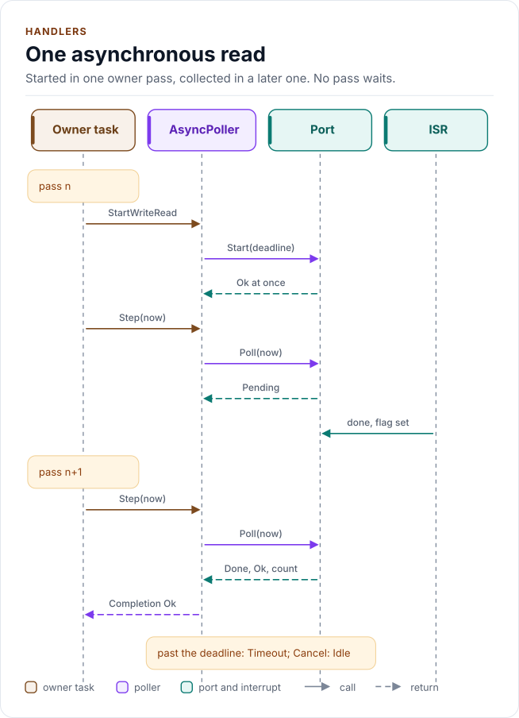
</picture>
<!-- /figure -->

Figure module: [`docs/diagrams/figures/async-poll.py`](../../docs/diagrams/figures/async-poll.py)

## Held transactions

<!-- figure: bus-hold -->
<picture>
  <source media="(prefers-color-scheme: dark)" srcset="bus-hold.dark.svg">
  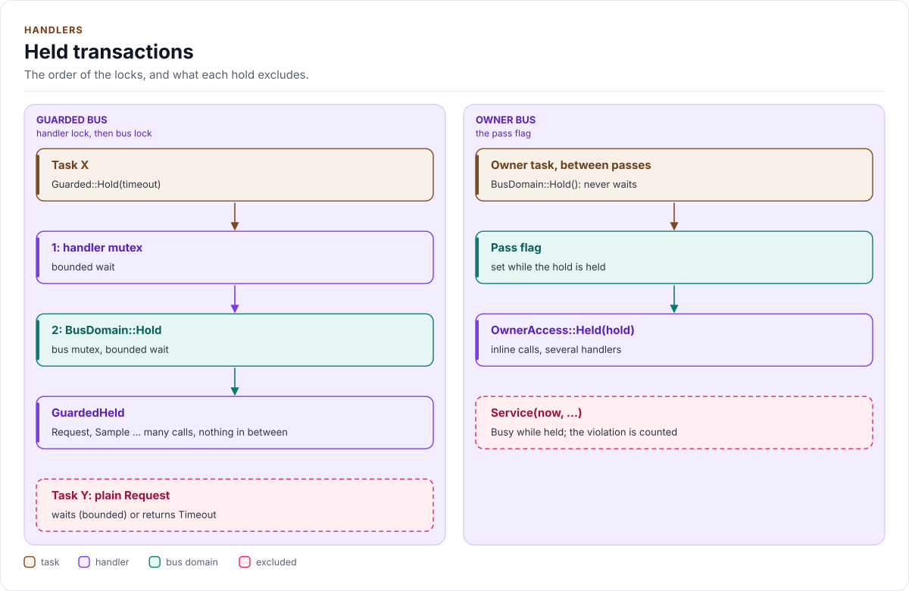
</picture>
<!-- /figure -->

Figure module: [`docs/diagrams/figures/bus-hold.py`](../../docs/diagrams/figures/bus-hold.py)

## One call through the layers

<!-- figure: call-sequence -->
<picture>
  <source media="(prefers-color-scheme: dark)" srcset="call-sequence.dark.svg">
  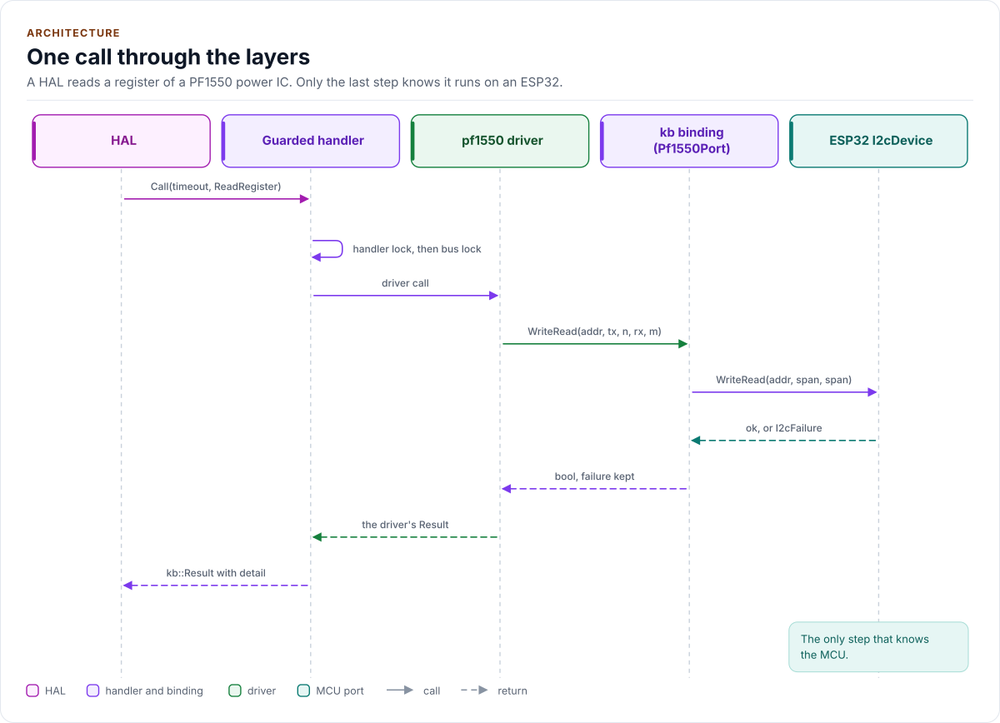
</picture>
<!-- /figure -->

Figure module: [`docs/diagrams/figures/call-sequence.py`](../../docs/diagrams/figures/call-sequence.py)

## The CI flow

<!-- figure: ci-flow -->
<picture>
  <source media="(prefers-color-scheme: dark)" srcset="ci-flow.dark.svg">
  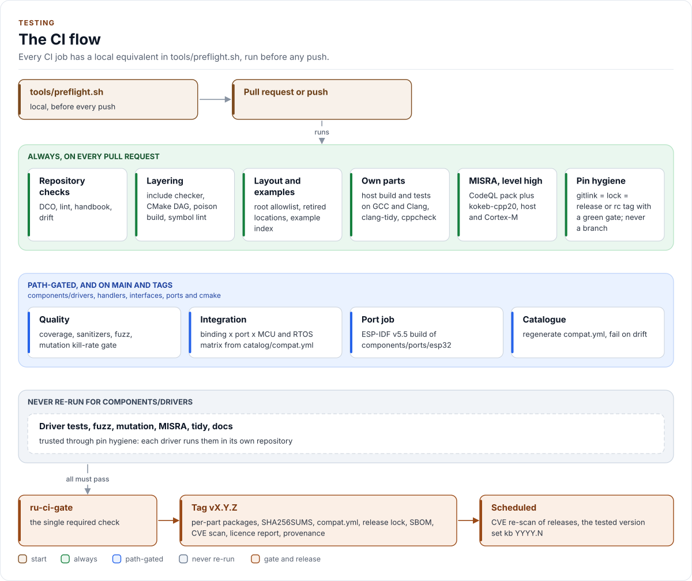
</picture>
<!-- /figure -->

Figure module: [`docs/diagrams/figures/ci-flow.py`](../../docs/diagrams/figures/ci-flow.py)

## Parts, ports and drivers

<!-- figure: components-map -->
<picture>
  <source media="(prefers-color-scheme: dark)" srcset="components-map.dark.svg">
  
</picture>
<!-- /figure -->

Figure module: [`docs/diagrams/figures/components-map.py`](../../docs/diagrams/figures/components-map.py)

Drawn from:

- [`components/lib`](../../components/lib)
- [`components/ports`](../../components/ports)
- [`components/drivers`](../../components/drivers)

## Which layer may depend on which

<!-- figure: dependency-rules -->
<picture>
  <source media="(prefers-color-scheme: dark)" srcset="dependency-rules.dark.svg">
  
</picture>
<!-- /figure -->

Figure module: [`docs/diagrams/figures/dependency-rules.py`](../../docs/diagrams/figures/dependency-rules.py)

## Ownership of a DMA buffer

<!-- figure: dma-lease -->
<picture>
  <source media="(prefers-color-scheme: dark)" srcset="dma-lease.dark.svg">
  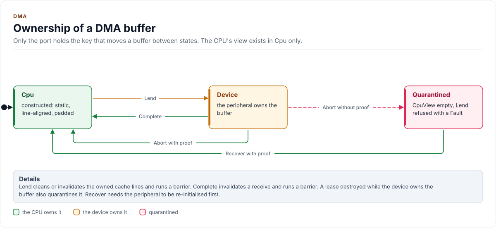
</picture>
<!-- /figure -->

Figure module: [`docs/diagrams/figures/dma-lease.py`](../../docs/diagrams/figures/dma-lease.py)

## The DMA copy-out stream

<!-- figure: dma-stream -->
<picture>
  <source media="(prefers-color-scheme: dark)" srcset="dma-stream.dark.svg">
  
</picture>
<!-- /figure -->

Figure module: [`docs/diagrams/figures/dma-stream.py`](../../docs/diagrams/figures/dma-stream.py)

## Fault evidence path

<!-- figure: fault-journal -->
<picture>
  <source media="(prefers-color-scheme: dark)" srcset="fault-journal.dark.svg">
  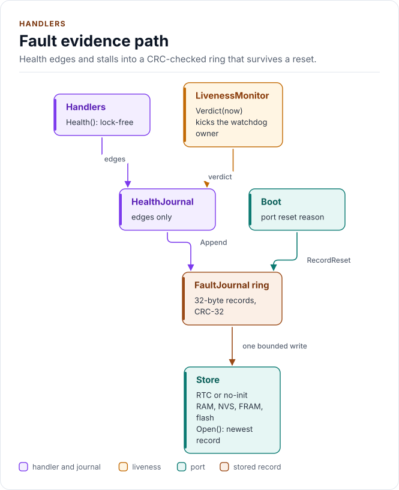
</picture>
<!-- /figure -->

Figure module: [`docs/diagrams/figures/fault-journal.py`](../../docs/diagrams/figures/fault-journal.py)

## Generators and the configurator

<!-- figure: generator-flow -->
<picture>
  <source media="(prefers-color-scheme: dark)" srcset="generator-flow.dark.svg">
  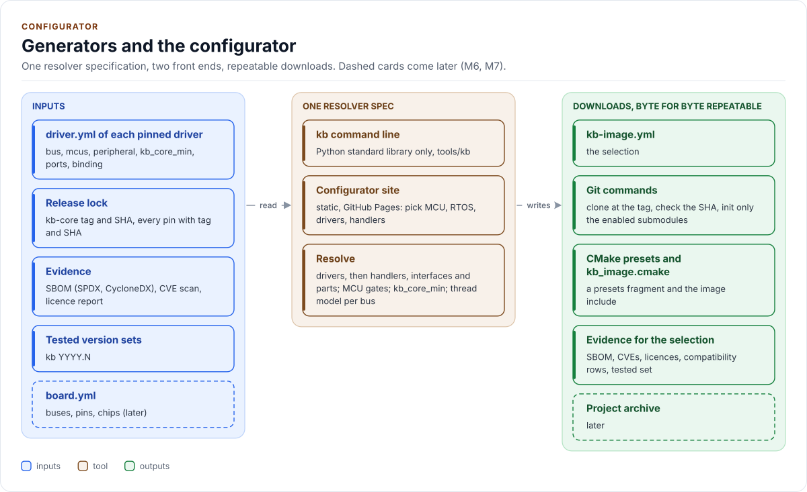
</picture>
<!-- /figure -->

Figure module: [`docs/diagrams/figures/generator-flow.py`](../../docs/diagrams/figures/generator-flow.py)

## Handler lifecycle and health

<!-- figure: handler-health -->
<picture>
  <source media="(prefers-color-scheme: dark)" srcset="handler-health.dark.svg">
  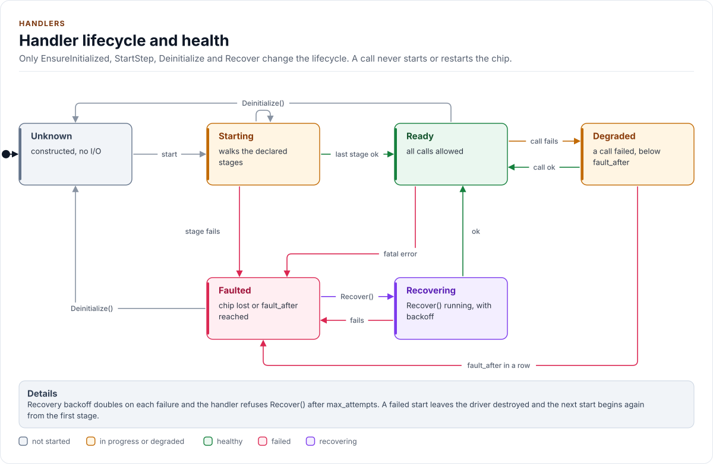
</picture>
<!-- /figure -->

Figure module: [`docs/diagrams/figures/handler-health.py`](../../docs/diagrams/figures/handler-health.py)

## The pieces of a handler

<!-- figure: handler-pieces -->
<picture>
  <source media="(prefers-color-scheme: dark)" srcset="handler-pieces.dark.svg">
  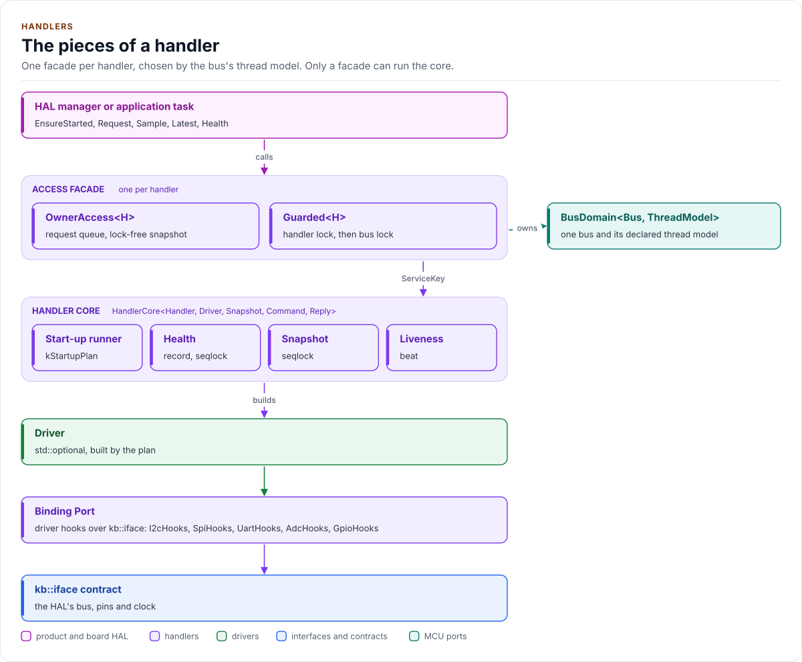
</picture>
<!-- /figure -->

Figure module: [`docs/diagrams/figures/handler-pieces.py`](../../docs/diagrams/figures/handler-pieces.py)

## The handler start-up pipeline

<!-- figure: handler-startup -->
<picture>
  <source media="(prefers-color-scheme: dark)" srcset="handler-startup.dark.svg">
  
</picture>
<!-- /figure -->

Figure module: [`docs/diagrams/figures/handler-startup.py`](../../docs/diagrams/figures/handler-startup.py)

## Handler thread models

<!-- figure: handler-threading -->
<picture>
  <source media="(prefers-color-scheme: dark)" srcset="handler-threading.dark.svg">
  
</picture>
<!-- /figure -->

Figure module: [`docs/diagrams/figures/handler-threading.py`](../../docs/diagrams/figures/handler-threading.py)

## The layer stack

<!-- figure: layer-stack -->
<picture>
  <source media="(prefers-color-scheme: dark)" srcset="layer-stack.dark.svg">
  
</picture>
<!-- /figure -->

Figure module: [`docs/diagrams/figures/layer-stack.py`](../../docs/diagrams/figures/layer-stack.py)

## MISRA C++:2023 scope

<!-- figure: misra-scope -->
<picture>
  <source media="(prefers-color-scheme: dark)" srcset="misra-scope.dark.svg">
  
</picture>
<!-- /figure -->

Figure module: [`docs/diagrams/figures/misra-scope.py`](../../docs/diagrams/figures/misra-scope.py)

## The kb repository family

<!-- figure: repo-family -->
<picture>
  <source media="(prefers-color-scheme: dark)" srcset="repo-family.dark.svg">
  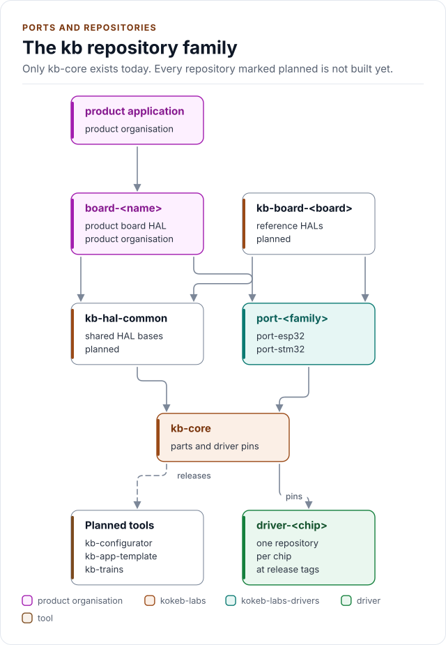
</picture>
<!-- /figure -->

Figure module: [`docs/diagrams/figures/repo-family.py`](../../docs/diagrams/figures/repo-family.py)

## Phase roadmap

<!-- figure: roadmap -->
<picture>
  <source media="(prefers-color-scheme: dark)" srcset="roadmap.dark.svg">
  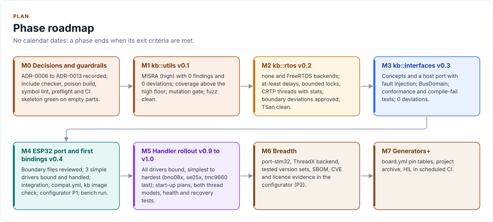
</picture>
<!-- /figure -->

Figure module: [`docs/diagrams/figures/roadmap.py`](../../docs/diagrams/figures/roadmap.py)

## kb::rtos backends

<!-- figure: rtos-backends -->
<picture>
  <source media="(prefers-color-scheme: dark)" srcset="rtos-backends.dark.svg">
  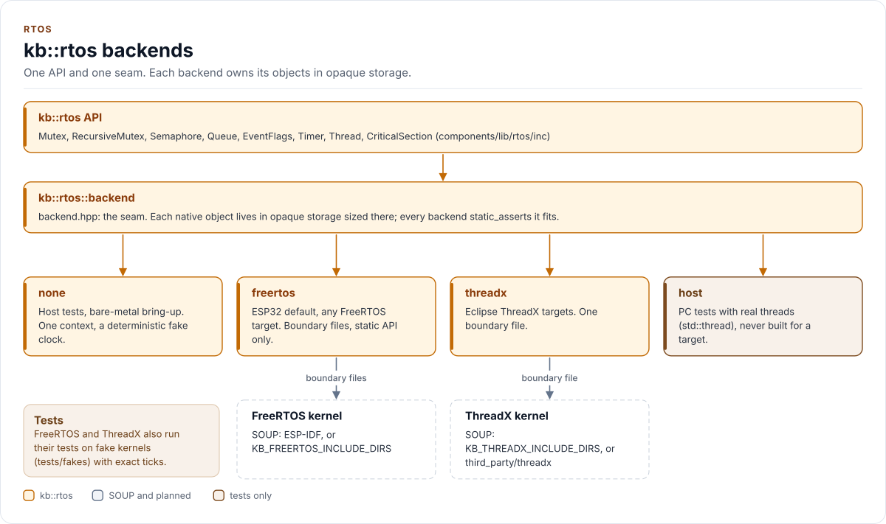
</picture>
<!-- /figure -->

Figure module: [`docs/diagrams/figures/rtos-backends.py`](../../docs/diagrams/figures/rtos-backends.py)

## The ThreadX backend

<!-- figure: rtos-threadx -->
<picture>
  <source media="(prefers-color-scheme: dark)" srcset="rtos-threadx.dark.svg">
  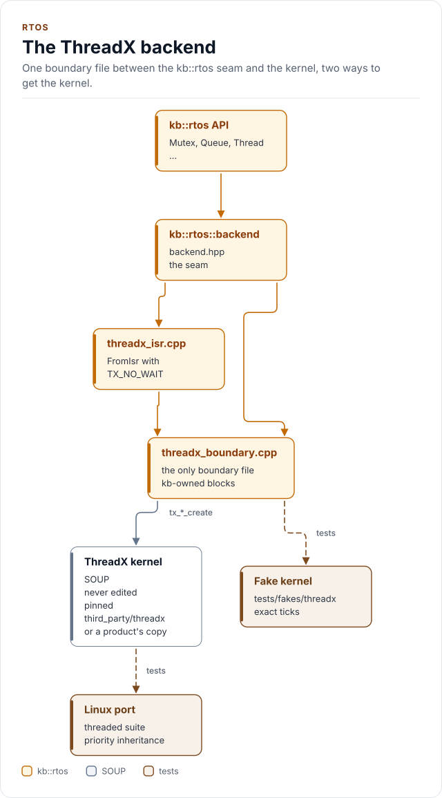
</picture>
<!-- /figure -->

Figure module: [`docs/diagrams/figures/rtos-threadx.py`](../../docs/diagrams/figures/rtos-threadx.py)

## The update path

<!-- figure: update-path -->
<picture>
  <source media="(prefers-color-scheme: dark)" srcset="update-path.dark.svg">
  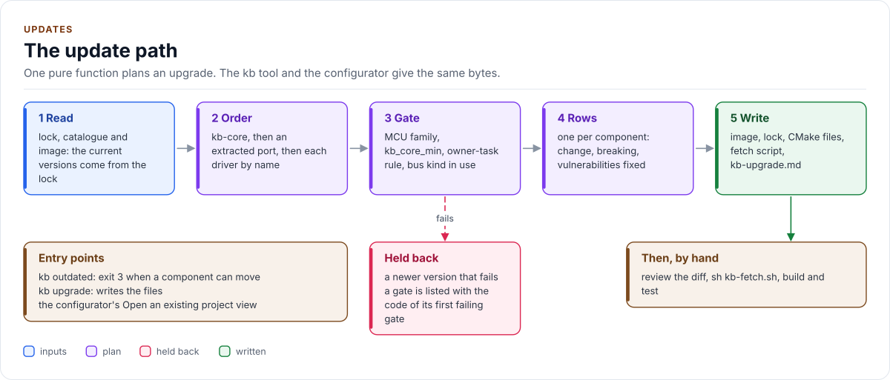
</picture>
<!-- /figure -->

Figure module: [`docs/diagrams/figures/update-path.py`](../../docs/diagrams/figures/update-path.py)
