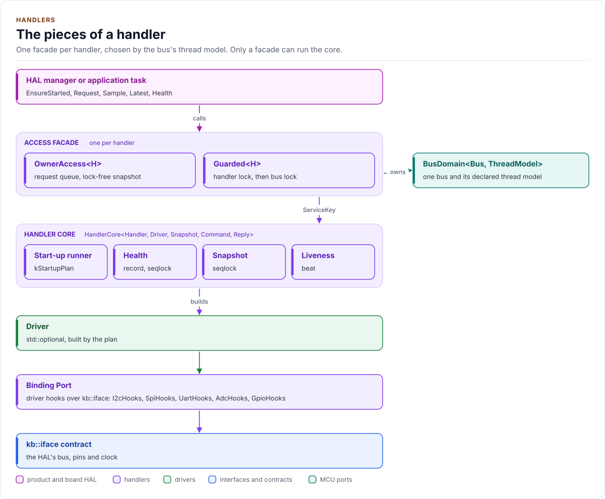
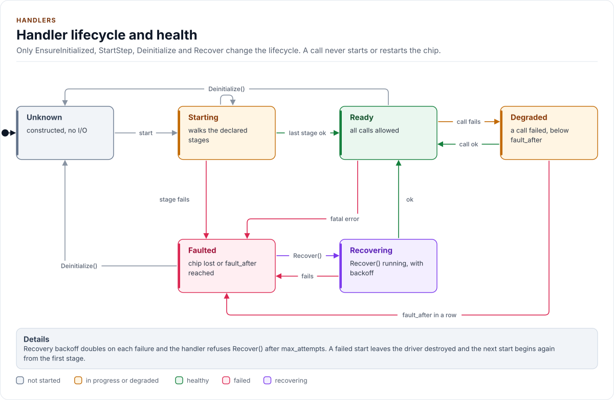

# Handlers

A handler binds one driver instance to one device on a bus, one configuration and a health record, and gives the
HAL a small typed API. Every handler is built the same way: a binding (the driver's port over kb contracts, the
error map, the start-up plan) and a handler class on the shared core. Decisions:
[ADR-0009](../adr/ADR-0009-handler-thread-models.md) (thread models) and
[ADR-0010](../adr/ADR-0010-handler-startup-pipeline.md) (start-up pipeline); design: [Handlers](../design/handlers.md).

## The pieces

<!-- figure: handler-pieces -->
<picture>
  <source media="(prefers-color-scheme: dark)" srcset="../diagrams/handler-pieces.dark.svg">
  
</picture>
<!-- /figure -->

| Piece | Header | What it does |
| --- | --- | --- |
| `HandlerCore` | `common/handler_core.hpp` | Lifecycle, start-up runner, health, snapshot, recovery with backoff |
| `HealthTracker`, `HealthRecord` | `common/health.hpp`, `common/types.hpp` | The one place health changes; a lock-free copy for any task |
| `BusDomain`, `BusHold` | `common/bus_domain.hpp` | One bus and its declared thread model |
| `OwnerAccess`, `RequestChannel` | `common/owner_access.hpp`, `common/request_channel.hpp` | Model O: the owner task services; other tasks post and wait |
| `Guarded` | `common/guarded.hpp` | Model G: bounded handler lock, then bounded bus lock |
| `I2cHooks` ... `GpioHooks`, `HookTiming` | `common/hooks.hpp` | Each driver hook once per bus kind: counters, failure recording, delays, clocks |
| `LivenessMonitor` | `common/liveness.hpp` | Which handlers stopped beating, for a watchdog task |
| `Seqlock` | `common/seqlock.hpp` | Single writer, many lock-free readers |

## Lifecycle and health

<!-- figure: handler-health -->
<picture>
  <source media="(prefers-color-scheme: dark)" srcset="../diagrams/handler-health.dark.svg">
  
</picture>
<!-- /figure -->

A call refused for the caller's own mistake (`InvalidArgument`) is recorded as the last error and counted in
`refused_calls`, but does not change the state. A binding may say which failures are fatal (`IsFatal`) and which
do not count (`CountsAgainstHealth`). On an owner bus, a successful periodic read clears the failures in a row, so
failing commands alone reach `fault_after` only between reads; bindings whose commands matter more than their
reads document a longer `sample_period`.

## Same caller API in both models

| Call | Owner model (`OwnerAccess`) | Guarded model (`Guarded`) |
| --- | --- | --- |
| `EnsureStarted(timeout)` | Asks the owner task, waits for the plan's end | Runs the plan under both locks |
| `Request(command, timeout)` | Posts to the bounded queue, waits for the reply (`Busy`, `Timeout`) | Runs the command under both locks (`Timeout`, nothing sent) |
| `Sample(timeout)` | The owner reads now and publishes | Reads now under both locks and publishes |
| `Latest()`, `Health()`, `Startup()` | Lock-free copies | Lock-free copies |
| `RequestRecovery(timeout)`, `Stop(timeout)` | On the owner task | Under both locks |

## The handlers

| Handler | Bus | Thread model | Start-up plan | Gives the application |
| --- | --- | --- | --- | --- |
| [mcp9700](mcp9700.md) | ADC | guarded | Identify + Configure | Temperature snapshot, raw millivolts |
| [ntc_thermistor](ntc_thermistor.md) | ADC | guarded | Identify + Configure | Temperature, resistance, raw code |
| [at25040b](at25040b.md) | SPI | guarded | Identify + Configure | Read, write (any length), block protection |
| [pca9685](pca9685.md) | I2C | guarded | Identify + Configure | Duty, pulse width, frequency, output enable |
| [pcal9555](pcal9555.md) | I2C | guarded | Identify + Configure | Inputs snapshot; write, set, toggle outputs; pulls, latches |
| [ads7952](ads7952.md) | SPI | owner (sampled) | Identify + Configure | Auto-1 scan snapshot, single channels, range, GPIO |
| [as5047u](as5047u.md) | SPI | owner (sampled) | Identify + Configure | Angle, velocity, field snapshot; zero, direction |
| [bmp581](bmp581.md) | I2C or SPI | guarded | Identify + Configure | Pressure and temperature, power modes |
| [ads9324](ads9324.md) | SPI | owner (sampled) | Identify + Configure | 16-channel frame snapshot, window alarms, power |
| [max22200](max22200.md) | SPI | guarded | Identify + Configure | Channels on and off, hold current, faults |
| [tle92466ed](tle92466ed.md) | SPI | guarded (owner with the SPI watchdog) | Identify + Configure | Channel currents, mission mode, feedback, faults |
| [sfm_flow_meter](sfm_flow_meter.md) | I2C | owner (sampled) | Boot + Identify (polled); Configure (polled, optional) | Flow sample snapshot; start, stop, averaging, sleep |
| [pf1550](pf1550.md) | I2C | guarded | Identify; Configure | Charger and rail status; rails, charger, standby, IRQs |
| [ws2812_rmt](ws2812_rmt.md) | pulse (RMT) | guarded | Link; Configure (optional) | Pixels, fill, brightness, show, power |
| [fdo2](fdo2.md) | UART | owner (sampled) | Power; Boot + Link + Identify (polled) | Oxygen snapshot; raw, identify, calibrations |
| [alicat_basis2](alicat_basis2.md) | UART | guarded | Link; Identify | Data frame snapshot; setpoint, valve, tare, gas |
| [dynamixel](dynamixel.md) | UART | owner (servo loop) | Link; Identify (polled, optional) | Feedback of every servo; torque, goal position, registers |
| [canopen_client](canopen_client.md) | CAN | owner (required) | Link; Configure (optional) | Node states, TPDOs, EMCY; NMT, SDO, CiA 402 drive |
| [isf15acp4](isf15acp4.md) | SPI | owner (switch polled) | Identify + Configure | Switch events; drawing, contrast, display power |
| [tmc5160](tmc5160.md) | SPI or UART | guarded | Identify + Configure | Motion snapshot; enable, move, velocity, stop, current |
| [bno08x](bno08x.md) | I2C, SPI or UART | owner (required) | HostReset; Boot + Link (polled); Configure (polled) | Sensor samples and operation records; sensors, tare |
| [se05x](se05x.md) | I2C | guarded | Link + Identify + Secure; Verify (optional) | Random, identity, objects, attestation, sign and verify |
| [tmc9660](tmc9660.md) | SPI or UART | guarded | Identify + Configure | Drive snapshot; enable, targets, parameters |

se05x is built only with `KB_ENABLE_SE05X=ON` and `KB_DRIVER_SE05X_DIR` until its driver is published.

## Tests

- `components/lib/handlers/tests/`: the core on the deterministic none backend, both facades, and real threads on the
  host
  backend (contention, lock timeouts, recovery storms, seqlock readers); compile-fail tests for a wrong facade, a
  wrong bus kind, `Guarded` over a chip that requires an owner, a missing `ServiceKey` and a plan out of order.
- `components/lib/handlers/fuzz/`: the request queue against a model of its slot protocol.
- `tests/integration/<name>/`: each binding drives its real driver over a kb contract backed by the driver's own
  chip model, in both thread models (owner only where the chip requires it).
- `tools/mutants/handlers.txt`: a mutant per rule of ADR-0009 and ADR-0010 that a test must catch.
