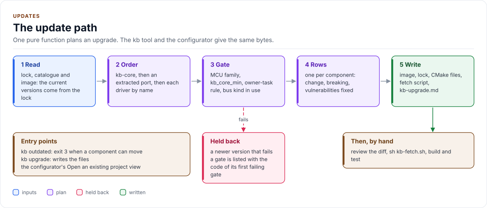

# The kb tool

`kb` builds the catalogue, resolves a `kb-image.yml` into a lock and the files a build needs, lists and applies
upgrades to newer catalogued versions, and writes SBOMs from a lock. It implements the
[resolver specification](design/assembler.md) of [ADR-0014](adr/ADR-0014-kb-core-is-the-assembler.md); the
configurator site implements the same rules and passes the same vectors.

Python 3.10 or newer and the standard library; PyYAML only to read YAML files (JSON input, and a lock, which is
JSON after one comment line, need nothing else).

```bash
python3 tools/kb/kb.py --help          # from the kb-core root
cd tools && python3 -m kb --help       # or as a module
```

## Build a catalogue

```bash
# Offline, from local clones: a driver clone or a folder of driver-* clones, plus kb-core's own tags and pins
python3 tools/kb/kb.py catalog build --drivers-dir ../drivers --kb-core-dir . -o catalog.json

# The working revision of kb-core as an unreleased version (warned as KB-RES-W03 when used)
python3 tools/kb/kb.py catalog build --drivers-dir ../drivers --kb-core-dir . --include-head -o catalog.json

# Online, with gh (logged in): every driver-* repository of the organisation, or some of them
python3 tools/kb/kb.py catalog build --online --org kokeb-labs-drivers --repo driver-pcal9555 -o catalog.json

# Binding facts (requires_owner) from the configurator's platform file, until a kb-core release records them
python3 tools/kb/kb.py catalog build --drivers-dir ../drivers --platforms configurator/data/platforms.json -o catalog.json
```

Only `vX.Y.Z` and `vX.Y.Z-rc.N` tags are read. A `driver.yml` that disagrees with its tag (name, version) or has
an invalid field is reported and left out; the command then exits 1.

## Resolve an image

```bash
python3 tools/kb/kb.py resolve kb-image.yml --catalog catalog.json -o out/
```

| Exit | Meaning |
| --- | --- |
| 0 | Resolved; `out/` holds `kb-image.lock.yml`, `CMakePresets.json`, `kb_image.cmake`, `kb-fetch.sh` |
| 1 | The image does not resolve: one line per error, `error KB-RES-NNN <subject>: <message>` |
| 2 | Bad arguments, or a file that cannot be read or parsed |

Warnings (`warning KB-RES-WNN ...`) go to standard error and do not change the exit code. Without `-o` the lock is
written to standard output. Copy the files to the root of your project's git repository and run `sh kb-fetch.sh`:
it adds kb-core, the port and every driver as submodules under `external/` at their tags, checks each commit
against the lock and refuses a moved tag. `sh kb-fetch.sh --verify` (in CI, for example) only checks that every
submodule is still at its pinned commit. `kb_image.cmake` and the presets point each `KB_DRIVER_<NAME>_DIR` at
`external/drivers/`.

## Find and apply upgrades

<!-- figure: update-path -->
<picture>
  <source media="(prefers-color-scheme: dark)" srcset="diagrams/update-path.dark.svg">
  
</picture>
<!-- /figure -->

```bash
# What can move: one row per component (kb-core, an extracted port, each driver)
python3 tools/kb/kb.py outdated kb-image.yml --catalog catalog.json
python3 tools/kb/kb.py outdated kb-image.yml --catalog catalog.json --allow-rc --json

# Write the upgraded project: kb-image.yml, its lock, CMake files, kb-fetch.sh and kb-upgrade.md
python3 tools/kb/kb.py upgrade kb-image.yml --catalog catalog.json -o .
python3 tools/kb/kb.py upgrade kb-image.yml --catalog catalog.json --to kb-core=0.4.1 --to bmp581=0.2.0 -o .
```

`--catalog` takes kb's catalogue (`kb catalog build`, or a kb-core release's `catalog.json`) or the configurator's
`configurator/data/catalog.json`, which `kb` converts exactly as the page does, so both plan the same thing; any other
file is refused with exit 2. Both read the project's current versions from `kb-image.lock.yml` beside the image (or
`--lock FILE`; `--no-lock` ignores it): an image may leave versions out, and without its lock "current" would mean
today's newest. kb-core moves first, then an extracted port, then every driver to its newest **release** (`--allow-rc`
also takes release candidates) that passes the gates against the new kb-core: MCU family, `kb_core_min`, the owner-task
rule and the bus kind in use. A newer version that fails a gate is listed as *held back* with the gate's code.
`--to NAME=VERSION` (repeatable; `kb-core`, `port-<family>` or a driver) moves one component to exactly that version, a
release candidate or a kb-core development revision included; a downgrade is refused. A lock whose commit (or kind) for
a version differs from the catalogue's, such as a kb-core development revision whose version has since been tagged or a
moved tag, is shown as a change (`prerelease` or `commit`) and warned with `KB-UPG-W04`. The rules are the [upgrade
section](design/assembler.md#upgrades) of the resolver specification, and the configurator's *Open an existing project*
view applies the same rules and, given the same catalogue, writes the same bytes.

`kb-upgrade.md` lists each component's change (`major`, `minor`, `patch`, `prerelease`), whether it is breaking by
SemVer (a new major; before 1.0 a new minor; before 0.1 a new patch) with a link to the new tag's release page, the
held-back versions, the known vulnerabilities fixed and still present (from the catalogue's `osv` scans, or *not
scanned*), the warnings and the next steps. `-o .` rewrites the project's `kb-image.yml` in one fixed style (comments
and layout are not kept). Review the diff, run `sh kb-fetch.sh` to move every submodule, then build and test.

| Exit | `kb outdated` | `kb upgrade` |
| --- | --- | --- |
| 0 | every component is at its newest selectable version | the files are written (or the report printed) |
| 1 | the plan fails: `error KB-UPG-NNN` or `KB-RES-NNN` lines | the same |
| 2 | bad arguments, or a file that cannot be read | the same |
| 3 | at least one component can move | not used |

## Write an SBOM

```bash
python3 tools/kb/kb.py sbom out/kb-image.lock.yml --format cyclonedx -o image.cdx.json
python3 tools/kb/kb.py sbom out/kb-image.lock.yml --format spdx -o image.spdx.json
```

The same lock always gives the same bytes: the CycloneDX serial number and the SPDX namespace derive from the
lock's SHA-256, and no clock is read. `--created` (or `SOURCE_DATE_EPOCH`) adds a creation time; SPDX, which
requires one, otherwise uses `1970-01-01T00:00:00Z`. The SDK and RTOS (ESP-IDF, FreeRTOS, ThreadX when selected)
are listed as SOUP. Every top-level component carries a `kb:osv` property (CycloneDX) or comment (SPDX) with its
known-vulnerability scan: from `--catalog catalog.json` when its versions carry scans, else `not scanned`.

## Check a board's DMA and generate its files

```bash
python3 tools/kb/kb.py image check examples/boards/stm32h743-dma/board.yml
python3 tools/kb/kb.py board gen examples/boards/stm32h743-dma/board.yml -o out/
python3 tools/kb/kb.py image check --selftest
```

`image check` runs the rules R1 to R15 of a `board.yml` against the routing data in `tools/kb/data/dma/`;
`board gen` writes `board_dma.hpp`, `board_dma.cpp`, `kb_dma.ld`, `board_mpu.hpp` and a report. Options: `--sdkconfig
FILE` (ESP-IDF options, R13), `--drivers FILE` (frame sizes by driver), `--json` (the result for tools), `--strict`
(warnings fail). `--selftest` runs the board vectors. `python3 tools/kb/dmadata.py --export-json OUT` writes the data
as one JSON bundle for the configurator. Reference: [Board DMA](design/board-dma.md).

| Exit | Meaning |
| --- | --- |
| 0 | The board checks (warnings go to standard error) |
| 1 | An error finding, or a warning with `--strict`: one line per finding, `error dma.<code> <subject>: <message>` |
| 2 | Bad arguments, or a file that cannot be read or parsed |

## Tests

```bash
python3 tools/kb/tests/run.py              # unit tests and every vector (exit 77 without PyYAML; 1 in CI)
node tests/resolver/run_js_vectors.mjs     # the same and the upgrade vectors through configurator/resolver.mjs
```

Both run under CTest with `-DKB_BUILD_TESTS=ON` (`kb_cli_unit`, `kb_resolver_js_vectors`).
