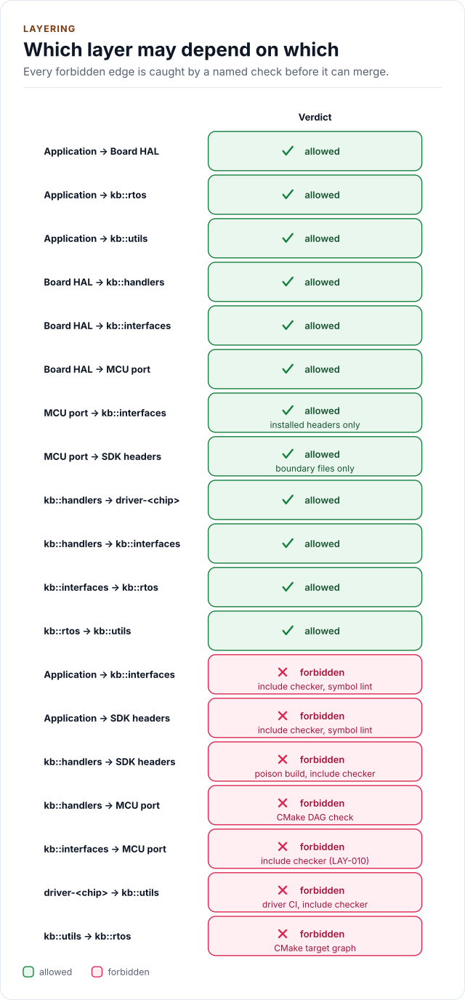

# Layering rules

What may depend on and include what, and the checks that enforce it ([ADR-0001](adr/ADR-0001-layering.md),
[ADR-0007](adr/ADR-0007-mcu-ports-isolated.md)).

<!-- figure: dependency-rules -->
<picture>
  <source media="(prefers-color-scheme: dark)" srcset="diagrams/dependency-rules.dark.svg">
  
</picture>
<!-- /figure -->

## Rules

1. Dependencies point down only: `utils <- rtos <- interfaces <- handlers`.
2. Applications reach hardware only through their HAL: they never include `kb/interfaces/...` or
   `kb/handlers/...` and never link `kb::interfaces` or `kb::handlers`. They may use `kb::utils` and `kb::rtos`.
3. SDK and RTOS headers appear only in the `.cpp` files listed in a `boundary-files.yml`: kb-core's own
   (`deviations/boundary-files.yml`, RTOS backends) and each port's
   (`components/ports/<mcu>/deviations/boundary-files.yml`).
   No public header includes one.
4. An MCU port uses kb-core only through its public, installed headers; nothing in `components/lib/` includes anything
   from
   `components/ports/`.
5. No `#if` on a platform macro above those files. The build selects folders; code does not select itself.
6. No board or product value in kb-core: pins, addresses, rail tables and timeouts arrive as configuration.
7. Drivers include nothing from kb-core, and kb-core never modifies a driver.

## Enforcement

| Check | Catches | Where |
| --- | --- | --- |
| CMake visibility | A consumer that did not link a part cannot find its headers; backends are PRIVATE; a port sees only the installed package | `cmake/kb_part.cmake`, each `components/lib/<part>/CMakeLists.txt`, `components/ports/<mcu>/CMakeLists.txt` |
| Include and dependency checker | An include across a forbidden boundary, an SDK include outside a boundary file, an include across the port seam, a target link against the DAG, an application including interfaces or handlers | `tools/include_checker/` (spec), CI `ci-layering.yml` |
| Poison build | An `#if` on an MCU or SDK macro in platform-free code | `tests/poison/` |
| Symbol lint | An application or platform-free object referencing an SDK or native RTOS symbol | `tools/include_checker/` (spec) |

A HAL runs the same checker with its own zone file, which adds its private, public and application zones.
