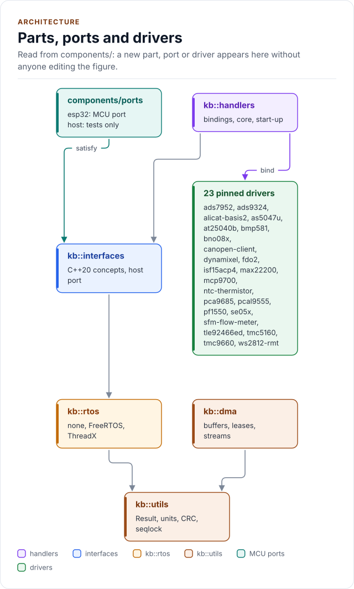

# Repository layout

Where things live is decided once, in
[`tools/layout/paths.yml`](https://github.com/kokeb-labs/kb-core/blob/main/tools/layout/paths.yml).
CMake, the tools, `tools/preflight.sh` and the tests read that file; none of them spells out a location, so another
grouping is a change of one line there. Prose, workflow files and YAML cannot read it and carry the literal path;
a check fails when one still names a retired location.

## Top level

<!-- figure: components-map -->
<picture>
  <source media="(prefers-color-scheme: dark)" srcset="diagrams/components-map.dark.svg">
  
</picture>
<!-- /figure -->

| Folder | Holds |
| --- | --- |
| `components/lib/` | The four parts: `utils`, `rtos`, `interfaces`, `handlers` (one CMake target and package each) |
| `components/ports/` | `esp32` (own CMake project, moves to `port-esp32`) and `host` (the std::thread RTOS backend, built in kb-core's project) |
| `components/drivers/` | Driver submodules pinned to release or rc tags, and `drivers.lock.yml` |
| `examples/` | Programs built in CI and shown in these pages; [the example index](examples.md) |
| `catalog/` | `compat.yml` (generated) and the JSON schemas in `catalog/schemas/` |
| `tests/`, `tools/`, `docs/`, `configurator/` | Repository tests, tools, this site, the hosted configurator |
| `third_party/` | Pinned third-party sources used for tests and cross builds (SOUP): the Eclipse ThreadX submodule |
| `_config/`, `deviations/`, `cmake/`, `.kokeb/`, `.github/` | Organisation-wide conventions, kept at the root |

`components/` groups the three kinds of component that sit next to each other: libraries, ports and drivers.
Files at the root are `README.md`, `AGENTS.md`, `CHANGELOG.md`, `LICENSE`, `CMakeLists.txt`, `.gitignore` and
`.gitmodules`; nothing else is allowed there.

## One file, three readers

`tools/layout/paths.yml` has four sections, all flat `key: value` and `- item` lines so that CMake, Python and
Node can each read it with a few lines of code:

- `layout`: name to path (`lib`, `ports`, `drivers`, `host_port`, `schemas`, `examples`, ...).
- `retired`: former paths and the name they became, so a stale reference can be found and rewritten.
- `vendor`: the files a consumer that keeps a pinned copy of kb-core needs (see below).
- `root_dirs`, `root_files`: the allowlist of top-level entries.

| Reader | How |
| --- | --- |
| CMake | `include(cmake/kb_layout.cmake)`, then `kb_layout(lib VAR)` or the variables `KB_LIB_DIR`, `KB_PORTS_DIR`, `KB_DRIVERS_DIR`, `KB_HOST_PORT_DIR`, `KB_TESTS_DIR`, ... (and `KB_<NAME>_REL`) |
| Scripts | `python3 tools/layout/layout.py get lib` (`--abs` for an absolute path), `layout.py list` |
| Python tools | `tools/layout/layout.py` as a module; the `kb` tool through `tools/kb/repolayout.py` |
| Tests | the same module; `tools/layout/tests/` checks that CMake and Python read the same values |

Checks, run by `tools/preflight.sh`, by ctest (`kb_layout_*`, `kb_examples_*`) and by `ci-layout.yml`:

- `layout.py root`: fails on a top-level entry that is not in `root_dirs` or `root_files`.
- `layout.py stale`: fails when a tracked file still names a retired location; `stale --fix` rewrites it.

### Changing the grouping

1. `git mv` the folders (submodules included) and edit the values under `layout`.
2. Add the old values under `retired`, then `python3 tools/layout/layout.py stale --fix` and review the diff.
3. Update `root_dirs` if a top-level folder appeared or went, and `vendor` if the set of copied files changed.
4. Run `tools/preflight.sh`.

## Where things moved

| Old | New |
| --- | --- |
| `lib/` | `components/lib/` |
| `ports/` | `components/ports/` |
| `drivers/` (the submodules `drivers/driver-<chip>` and `drivers/drivers.lock.yml`) | `components/drivers/` |
| `host/rtos/CMakeLists.txt` | `components/ports/host/CMakeLists.txt` |
| `host/rtos/README.md` | `components/ports/host/README.md` |
| `host/rtos/host_backend.cpp` | `components/ports/host/src/host_backend.cpp` |
| `schemas/` | `catalog/schemas/` |

Unchanged: `.github/`, `.kokeb/`, `_config/`, `catalog/` (its files), `cmake/`, `configurator/`, `deviations/`, `docs/`,
`examples/`, `tests/`, `tools/`. New: `components/` (the parent of the moved folders), `cmake/kb_layout.cmake`,
`tools/layout/`, `tools/examples/`, `tools/kb/repolayout.py`, `examples/CMakeLists.txt`, `examples/examples.yml`,
`examples/host/*`, `docs/examples.md`, `.github/workflows/ci-layout.yml`.

The JSON schema `$id` URLs (`https://kokeb-labs.github.io/kb-core/schemas/...`) are published addresses, not
repository paths, and did not change.

## If you keep a copy of kb-core

The MCU port repositories (`port-esp32`, `port-stm32`) keep an unchanged copy of the kb-core files they build
against in `third_party/kb-core`, recorded in `third_party/kb-core.lock` (a `repo`, `commit` and `ref` line, then one
`<sha256>  <path>` line per file) and re-hashed by CMake at configure time ("kb-core copy: N files equal the
lock"). The lock format does not change. What changes is the set of paths the snapshot tool
(`tools/kb_core_snapshot.py`, its `PATHS`) copies, and therefore the paths inside the lock:

| `PATHS` entry before | After |
| --- | --- |
| `lib/<part>/...` (utils, rtos, interfaces: `CMakeLists.txt`, `inc`, `backends/none`, `backends/freertos`, `host`) | `components/lib/<part>/...` |
| `host/rtos` | `components/ports/host` |
| `cmake` (esp32 port) or the listed `cmake/*.cmake` files (stm32 port) | the same, plus `cmake/kb_layout.cmake` (and `cmake/kb_tool_tests.cmake` for a list that names files) |
| (none) | `tools/layout/paths.yml`, which `cmake/kb_layout.cmake` reads |
| `LICENSE`, `CMakeLists.txt`, `tests/harness` | unchanged |

The count rises by two files (`cmake/kb_layout.cmake`, `tools/layout/paths.yml`); the host RTOS backend is two files
before and after. The authoritative list is `python3 tools/layout/layout.py vendor` in the kb-core checkout, and the
test `kb_layout_unit` copies exactly that list into an empty folder and configures it, so the list cannot go stale
unnoticed. A copy without `tools/layout/paths.yml` stops at configure time and says so.

Other places in a consumer that name kb-core paths change the same way: layering rules that match
`third_party/kb-core/lib/<part>/inc/...` become `third_party/kb-core/components/lib/<part>/inc/...` (the harness
`tests/harness` stays), and the comment pointing at kb-core's `drivers/drivers.lock.yml` is now
`components/drivers/drivers.lock.yml`. An installed kb-core package (`find_package(kb)`) is unaffected: install
paths, targets (`kb::utils`, ...), headers and `kbConfig.cmake` did not change.

A `kb-image.lock.yml` written before the move records an in-tree port as `ports/esp32` or `lib/interfaces/host`;
those `path` values are now `components/ports/esp32` and `components/lib/interfaces/host`. The resolver and
`kb upgrade` write the new ones; the old values are informational only.

### Existing checkouts of kb-core

Driver submodules moved with `git mv`, so their commits and URLs are unchanged and their `.gitmodules` section names
are kept. In a checkout that has them populated, deinitialise them before switching to a commit after the move, then
initialise again:

```bash
git submodule deinit --all
git checkout <branch after the move>
git submodule update --init
```
