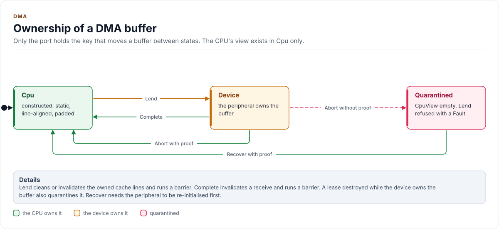
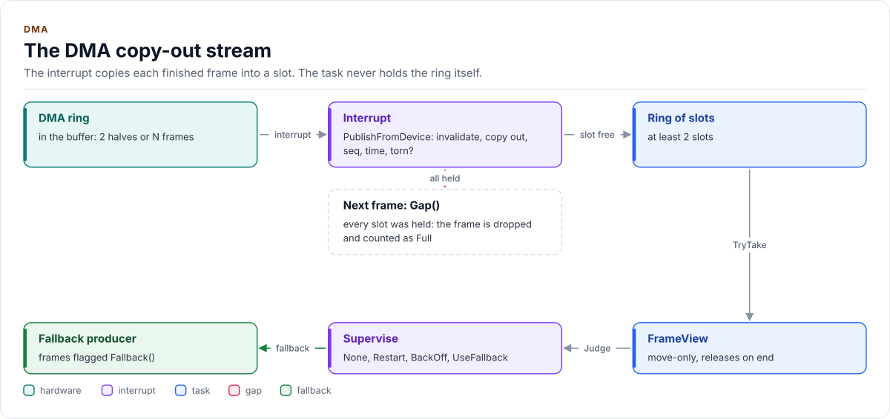

# kb::dma

Buffers that a DMA master reads or writes, and the streams built on them, with the cache rules, the ownership rules
and the failure rules written once. Header-only; depends on `kb::utils`. A port supplies the cache hooks and the
register code; a driver or handler gets a buffer it cannot misuse. Decisions: [ADR-0030](../adr/ADR-0030-dma-buffers-and-leases.md),
[ADR-0031](../adr/ADR-0031-dma-stream-copy-out.md), [ADR-0032](../adr/ADR-0032-dma-region-policy.md).

```cpp
#include "kb/dma/dma.hpp"
```

| Header | Gives | Contract in one line |
| --- | --- | --- |
| `region.hpp` | `Region` concept, `CachePolicy`, `Direction`, `MasterSet`, `RoundUp`, `RequireFrameFits`, `RequireReachable`, `RequireWholeUnits`, `RequireElementBytes` | A region states its cache policy, line size, alignment unit and the masters that reach it; a mismatch is a build error |
| `cache.hpp` | `CacheOps` concept, `NoCacheOps` | The port's `Clean`, `Invalidate`, `Barrier`; called only over lines the buffer owns |
| `buffer.hpp` | `Buffer<Region, Bytes>`, `Lease<Region>`, `PortKey<Tag>`, `BufferState`, `BufferStats` | Static, line-aligned and padded; the CPU has a view only while it owns the buffer; a lease is move-only |
| `completion.hpp` | `CompletionLatch`, `Outcome`, `StopEvidence`, `CancelClaim` | A transfer completes once and is reported once, whatever races a cancel |
| `stream.hpp` | `Stream<Frame, Frames, Region>`, `FrameView`, `StreamConfig`, `StreamStats`, `SupervisorAction` | Copy-out ring of at least two frames with sequence numbers, timestamps, overrun checks, a signed stall check and a restart policy |
| `capabilities.hpp` | `Capabilities`, `DmaHealth`, `TransferMode` | A port says which path serves (DMA, interrupt or polled) and its ceiling; a fallback is never silent |

## Ownership: a buffer is either the CPU's or the device's

<!-- figure: dma-lease -->
<picture>
  <source media="(prefers-color-scheme: dark)" srcset="../diagrams/dma-lease.dark.svg">
  
</picture>
<!-- /figure -->

A `Buffer` is a static object: aligned to its region's unit, padded to a whole number of units, so cache
maintenance over it never reaches a neighbour. `CpuView()` returns the data while the CPU owns the buffer and an
empty span otherwise (counted in `Stats().cpu_denied`). The port moves it with a `PortKey`, a passkey only the
port's own class can construct:

```cpp
Lease<Region> lease;
buffer.Lend(key, Direction::FromDevice, used, ops, lease);   // clean + invalidate the owned lines, barrier
// ... program the DMA with lease.DeviceView(key) ...
lease.Complete(key, ops, Outcome::Ok);                        // invalidate, barrier, the CPU owns it again
```

| Call | Result |
| --- | --- |
| `Lend` | `Ok`; `InvalidArgument` (bad length, or the lease is already active); `Busy` (on the device); `Fault` (quarantined) |
| `Complete` | Memory back to the CPU; `InvalidArgument` for an inactive lease |
| `Abort(Confirmed)` | Memory back to the CPU: the port saw the enable bit read 0 |
| `Abort(NotConfirmed)` | `Fault`, the buffer is quarantined: nobody may touch it while a master may still write |
| `Recover` | Only with proof, after the peripheral was re-initialised |
| destroying an active lease | Quarantines the buffer |

Cache maintenance per policy:

| Policy | Transmit lend | Receive lend | Receive return |
| --- | --- | --- | --- |
| `Coherent`, `NonCacheable` | barrier | barrier | barrier |
| `Maintained` | clean the used lines | clean, then invalidate all owned lines | invalidate the used lines |

The receive lend cleans before it invalidates so that a dirty line cannot be evicted over the data the device is
about to write. The default region on a part with a data cache is a non-cacheable block set up by the MPU
([ADR-0032](../adr/ADR-0032-dma-region-policy.md)).

## Streams: copy out, never lend the ring

<!-- figure: dma-stream -->
<picture>
  <source media="(prefers-color-scheme: dark)" srcset="../diagrams/dma-stream.dark.svg">
  
</picture>
<!-- /figure -->

`Stream<Frame, Frames, Region>` has at least two slots. The interrupt copies each finished hardware frame
(`PublishFromDevice`, which invalidates the frame's lines first) into a slot with a sequence number and the time
of the completion; the task takes the oldest frame (`TryTake`) and holds it while it reads (`FrameView`, released
on `Give` or when the view ends). Zero-copy is available only through a `Lease`.

| Situation | What happens |
| --- | --- |
| All slots held when a frame arrives | The frame is dropped and counted (`overruns`); the next delivered frame has `Gap()` and a larger sequence number |
| The peripheral overruns, or the pool overflows | `OnOverrun`: counted, never a frame, flags the next frame |
| The hardware lapped the copy (both flags pending, counter inside the half) | The frame is published `Torn` |
| No frame for `stall_periods` periods | `CheckStall`: signed elapsed time, so a frame stamped after the task read its clock is not a stall |
| The content check rejects `bad_frames_to_restart` frames in a row | `Supervise` returns `Restart` |
| A restart came too recently | `BackOff` |
| Restarts keep failing | `UseFallback`; frames from the declared fallback producer carry `Fallback()` and a new epoch |

One context publishes (the interrupt) and one context consumes (the owner task); the counters are atomics, the ring
indices are single-writer.

## What a port implements

| Piece | Rule |
| --- | --- |
| `CacheOps` | `Clean(range)`, `Invalidate(range)`, `Barrier()`; ranges are whole lines of the buffer, never a caller's memory |
| Start | Check `Buffer::Verify` once; `Lend`; program the transfer from `DeviceView(key)`; round a receive length up to the unit inside the padding |
| Completion | One interrupt path reads and clears the flags; `TryComplete` on a `CompletionLatch`, `Complete` the lease |
| Errors | Clear each flag by its own bit; report an error as an error; the first fault ends the transfer |
| Cancel | Disable the stream, wait for the enable bit to read 0 within a bound, then `Abort(Confirmed)`; otherwise `Abort(NotConfirmed)` and return `Fault` |
| Timeout | A timed-out transfer is cancelled the same way before the buffer is returned |
| Capabilities | `Capabilities()` says the mode, the ceiling and the staging size; `DmaHealth` carries the mode and a fault flag |
| Fallback | Interrupt or polled service up to a published ceiling, reported in `Capabilities()` and in the health record |

## Host model and conformance suite

`components/lib/dma/host` is a model of the hardware side: memory with a write-back cache (with speculative refills), a DMA
engine with bursts, a stuck mode and receive-length rounding, and a reference port with injectable defects. The
conformance suite `T1` to `T18` (`kb/dma/host/conformance.hpp`) runs against any rig with the same member
functions; each case passes on the good model and is shown to fail on a model with the defect it targets.

| Case | Defect it catches |
| --- | --- |
| T1 | transmit without a clean |
| T2 | receive without an invalidate (before or after) |
| T3 | an invalidate after a CPU-copy transfer |
| T4 | a receive target that shares a cache line with a neighbour |
| T5 | CPU access during a lease |
| T6 | a DMA write after a timeout returned the buffer |
| T7 | an abort that does not wait for the enable bit |
| T8 | receive-length rounding past an unpadded buffer |
| T9 | a held frame overwritten, an overrun not counted |
| T10 | a lapped copy published as clean |
| T11 | a half delivered twice by two drainers |
| T12 | an unsigned stall check |
| T13 | a pool overflow delivered as a frame |
| T14 | an error reported as success; the other pending flag lost to a global clear |
| T15 | a cancel racing a completion reporting twice |
| T16 | an unconfirmed stop returning the buffer to the CPU |
| T17 | an unreported fallback |
| T18 | a synchronous transfer making the caller's memory a DMA target |

## Compile-time checks

| Helper | Fails the build when |
| --- | --- |
| `RequireFrameFits<Driver, Port>` | the driver's largest frame exceeds the port's DMA limit |
| `RequireReachable<Masters, Region>` | a named DMA master cannot reach the region (tightly coupled memory) |
| `RequireWholeUnits<Bytes, Region>` | a size is not a multiple of the alignment unit |
| `RequireElementBytes<Element, Bytes>` | a stream element differs in size from the board declaration |
| `Region` concept | line or unit is not a power of two, the unit is smaller than a line, or a cached region has no line |
| `Stream<Frame, 1, ...>` | fewer than two frames |
| `RequireInterruptTier<Stream, Rtos>` | a stream that notifies a task runs above the RTOS syscall limit, or its priority is outside the implemented bits |
| `RequireSamePriority<S1, S2>` | the streams of one peripheral run at different interrupt priorities |
| `RequireBusCarries<Bus, Bytes>` | the driver's largest frame exceeds what the bus carries in the mode the board gave it |
| `RequireShape<Decl, Frame, Frames>` | the handler's frame size or ring length differs from the board's stream declaration |

## Board declarations

`kb/dma/assignment.hpp` holds the values the board generator writes into `board_dma.hpp` from `board.yml`: a
`StreamAssignment` per DMA stream (engine, stream, request line, arbitration priority, interrupt priority, how the
interrupt notifies the owner, which interrupts are on, normal or circular), the `InterruptLimits` of the RTOS, the
`BusLimits` of each bus (DMA or not, the largest frame each way, the receive-length multiple, the alignment unit) and
the `StreamShape` of each stream. A port receives a resolved assignment and only checks it with the helpers above; it
never looks for a free stream at run time. What `engine`, `stream` and `request` number is the port's to define (its
`docs/dma.md`).
