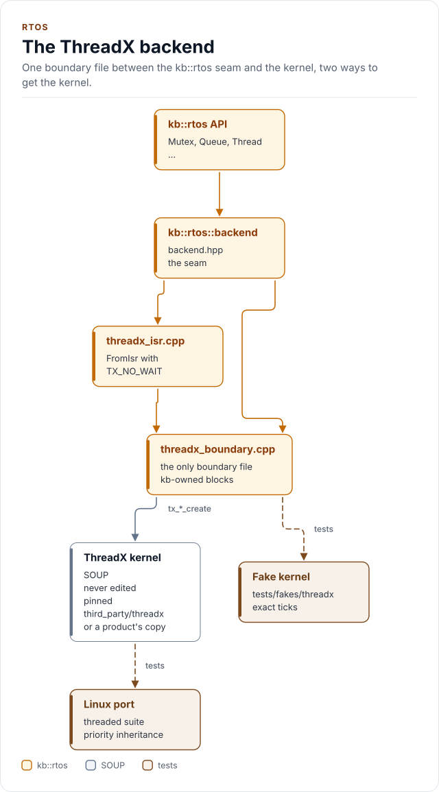

# ThreadX backend

`KB_RTOS=THREADX` runs the whole [`kb::rtos`](rtos.md) API on Eclipse ThreadX: the same classes, the same
contract (static allocation, waits of at least the time asked, bounded locks, fail-closed creation), the same tests
as the FreeRTOS backend. Why ThreadX is supported, with the evidence: [ADR-0015](../adr/ADR-0015-threadx-backend.md).

<!-- figure: rtos-threadx -->
<picture>
  <source media="(prefers-color-scheme: dark)" srcset="../diagrams/rtos-threadx.dark.svg">
  
</picture>
<!-- /figure -->

## Getting the kernel

ThreadX is SOUP: never copied into kb-core, never edited. The backend builds against one of two kernels, and the
configure stops when neither is given.

| You have | Configure with | Who links the kernel |
| --- | --- | --- |
| A kernel from your vendor tooling (STM32Cube, an SDK) | `-DKB_RTOS=THREADX -DKB_THREADX_INCLUDE_DIRS="<common/inc>;<port inc>;<tx_user.h dir>"`, `-DKB_THREADX_DEFINITIONS="<every TX_* define the kernel is compiled with>"` (at least `TX_INCLUDE_USER_DEFINE_FILE` when it uses `tx_user.h`) and `-DKB_THREADX_TICK_HZ=<its TX_TIMER_TICKS_PER_SECOND>` (required) | Your image, as before |
| Nothing yet | `-DKB_RTOS=THREADX -DKB_THREADX_PORT=cortex_m4` (any GNU port directory of the ThreadX kernel) and `git submodule update --init third_party/threadx`; `KB_THREADX_TICK_HZ` defaults to 1000 | Your image links the `threadx` target this builds |

`third_party/threadx` is the official `eclipse-threadx/threadx` repository at a release tag (the
[SOUP list](../assurance/soup.md) records which). `KB_THREADX_USER_FILE` picks the `tx_user.h` it is built with
(default `components/lib/rtos/threadx-config/kb_tx_user.h`, which takes the tick from `KB_THREADX_TICK_HZ`; any other user
file needs `KB_THREADX_TICK_HZ` given explicitly).

**The backend must see the kernel as the kernel was compiled.** It reads ThreadX control blocks (`TX_THREAD`,
`TX_MUTEX`, ...) whose layout depends on options such as `TX_ENABLE_STACK_CHECKING`, `TX_DISABLE_NOTIFY_CALLBACKS`
or the `TX_*_USER_EXTENSION` macros. With the pinned kernel the backend takes the kernel target's own include
directories and defines, so they always agree. With a product kernel, pass the same `tx_user.h` and the same
`TX_*` defines in `KB_THREADX_DEFINITIONS`; to have the build check it, also pass `KB_THREADX_THREAD_BYTES` (the
`sizeof(TX_THREAD)` your kernel build sees), and the backend fails to compile when its own differs.

## Kernel configuration

| Option | Required | Why |
| --- | --- | --- |
| `TX_NO_TIMER` not defined | Yes (a compile error otherwise) | Timeouts, sleeps and `kb::rtos::Timer` need the timer component |
| `TX_TIMER_TICKS_PER_SECOND` set on purpose, equal to the real tick | Yes (a compile error when it differs from `KB_THREADX_TICK_HZ`) | kb-core converts milliseconds with it, and `tx_api.h` silently defaults it to 100 when `tx_user.h` is not included. On Cortex-M the SysTick reload in the port's `tx_initialize_low_level.S` sets the real rate. kb-core's tests run at 1000 and, on the Linux port, also at 100 |
| `ULONG` of 32 bits or more | Yes (a compile error otherwise) | Ticks and flags are 32-bit in kb-core |
| `TX_ENABLE_STACK_CHECKING` | Recommended | `Thread::StackFreeBytes()` and ThreadX's own overflow detection; without it `StackFreeBytes()` is `Unsupported` |
| `TX_DISABLE_ERROR_CHECKING` | Either | kb-core checks its own arguments before every call; the kernel's checks are a second line |
| `TX_TIMER_PROCESS_IN_ISR` | Either | A `Timer` callback runs in "timer context" either way and must not block |
| `TX_MAX_PRIORITIES` | Any (32 by default) | kb priorities are clamped to it |
| `KB_THREADX_QUEUE_WORD_BYTES` (kb-core) | When `sizeof(ULONG)` is not 4 | The word queue slots are rounded to; a wrong value is a compile error. Only the ThreadX build rounds slots; other backends keep them at the item size |

## How the kb API maps

| kb-core | ThreadX | Note |
| --- | --- | --- |
| `Mutex` | `tx_mutex_create(..., TX_INHERIT)` | Priority inheritance. A ThreadX mutex nests; `kb::Mutex` does not: a second take by the holder fails after its timeout (at once for an unbounded wait) |
| `RecursiveMutex` | the same mutex | Nests; each take needs its unlock |
| `Semaphore` | `tx_semaphore_create`, `tx_semaphore_ceiling_put` | ThreadX has no maximum count: the ceiling put keeps kb's |
| `Queue<T, N>` | `tx_queue_create` on the kb buffer | ThreadX moves whole words: an item is copied through a word buffer, so any `T` up to 16 words (64 bytes on a 32-bit MCU) works; a larger one is `Unsupported` at `Create()` |
| `EventFlags` | `tx_event_flags_*` | Clear is a set with `TX_AND`; a wait returns the flags before any clear, or the flags now on a timeout |
| `Timer` | `tx_timer_create`, deactivated until `Start()` | The period in ticks (rounded up); `Start()` restarts the whole period. 32 timers at most (the expiry finds its timer in a table) |
| `Thread` | `tx_thread_create` on the kb stack, auto start, no time slice | kb priority p (higher first) is ThreadX `TX_MAX_PRIORITIES - 1 - p`, but never more urgent than `TX_TIMER_THREAD_PRIORITY + 1`, so no kb thread delays timeouts and timer callbacks (with 32 priorities: kb 0 to 30 are distinct, 30 and above share ThreadX 1); the name is copied (15 characters) |
| `Periodic`, the thread grid | `tx_thread_sleep` of the rest of the period | ThreadX has no delay-until; an overrun returns at once and is counted, and so is a wake-up after the grid point (a preemption between reading the tick and sleeping). The arithmetic is platform-free (`kb/rtos/backend_rules.hpp`) |
| `SleepFor(0)`, `Yield()` | `tx_thread_relinquish` | |
| `CriticalSection` | `tx_interrupt_control` | Nests; the outermost restores the posture it found |
| `Thread::StackFreeBytes()` | the kernel's highest stack pointer and the `0xEF` fill pattern | The lower of the two; needs `TX_ENABLE_STACK_CHECKING` |
| `...FromIsr()` | the same call with `TX_NO_WAIT` | ThreadX allows these from an interrupt; the port's interrupt exit reschedules, so there is no yield request. `Queue::SendFromIsr` puts one message buffer (16 words: 64 bytes on a 32-bit MCU) on the interrupt stack; size the ISR stack for it |

## Differences from FreeRTOS that a user can see

- **Object lifetime.** ThreadX keeps every created object on a kernel list, and kb objects are never deleted, so
  every `kb::rtos` object needs static storage (a global, a `static` local or a member of one), never a stack
  frame: a stack object would leave a dangling entry on the kernel's list when its frame ends. The rule is the same
  for every backend; on FreeRTOS a forgotten stack mutex or queue happens to be harmless, on ThreadX it is not.
  Nothing checks it yet (with `TX_DISABLE_ERROR_CHECKING` not even the kernel notices a re-created address).
- **A holder's unbounded retake.** `Mutex::TryLockFor(kb::kMaxMilliseconds)` by the thread that holds the mutex
  fails at once on ThreadX; on FreeRTOS it never returns. Both are a bug in the caller.
- **Mutexes from an interrupt** are not allowed on any backend. On ThreadX `tx_thread_identify()` in an interrupt
  returns the interrupted thread, so a misuse may look like the holder's retake; with a zero timeout it only fails.
- **Queue item size.** At most 16 native words per item (FreeRTOS has no limit).
- **Timers.** At most 32 at once; the callback may run in the tick interrupt when the kernel is built with
  `TX_TIMER_PROCESS_IN_ISR`.
- **Interrupt calls.** No `portYIELD_FROM_ISR`: the port's interrupt exit does it.
- **Priorities.** ThreadX numbers urgency the other way round; kb-core maps it, so `ThreadConfig::priority` means
  the same on both.

## What a port needs

An MCU port that runs ThreadX (`port-stm32` first) provides what the kernel needs and kb-core does not: the
kernel's low-level start-up (`tx_initialize_low_level`, the vector table entries for SysTick and PendSV, the tick
at `TX_TIMER_TICKS_PER_SECOND`), the call to `tx_kernel_enter()` and a `tx_application_define()` that runs the
image's composition root (where `kb::rtos` objects are created), and the configure options above. kb-core's own
`kb::MonotonicUs()` clock still comes from the port (handbook), not from the ThreadX tick.

## Tests

| Test | Kernel | What it proves |
| --- | --- | --- |
| `kb_rtos_tests_threadx` | fake (`tests/fakes/threadx`) | The single-context contract suite with exact tick counts, as on `none` and FreeRTOS, and the seam: creation failures, thread parameters and priority mapping, the non-recursive rule, semaphore maximum, odd-sized queue items, timer restart and table bound, critical-section posture, the tick wrap, delay-until, the stack high-water mark |
| `kb_rtos_tests_threadx_linux` | the pinned kernel, Linux port (`-DKB_THREADX_HOST_TESTS=ON`, Linux; the pre-flight runs it at `KB_THREADX_TICK_HZ` 1000 and 100) | The threaded suite of the host backend on real ThreadX threads (including a verified start and a join that end within two ticks of their timeout), plus priority inheritance resolving an inversion (the test fails with `TX_NO_INHERIT`), preemption by priority, and stack measurement |
| `test_backend_rules.cpp` (in `kb_rtos_tests_none`) | none | The platform-free delay-until, late wake-up, holder retake and tick-extension rules |
| Cortex-M cross-compile | the pinned kernel, `cortex_m0`, `cortex_m4`, `cortex_m7` ports | The backend and the kernel build for M0+, M4F and M7F with Arm GCC and kb-core's strict flags (`tools/preflight/threadx_cross.sh`) |

The Linux port runs each ThreadX thread on its own pthread stack, so on it the stack measurement is only checked to
be in range; the depth logic is checked on the fake kernel.
