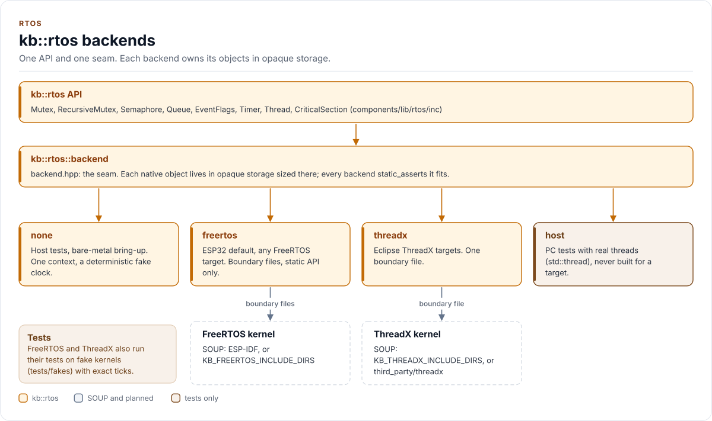

# kb::rtos

The only place a scheduler is touched. A small typed API (header-only, no RTOS type in any signature) over one
backend chosen by `KB_RTOS`. Depends on `kb::utils`; applications, the HAL, handlers and ports may all use it.

```cpp
#include "kb/rtos/rtos.hpp"
```

| Header | Gives | Contract in one line |
| --- | --- | --- |
| `time.hpp` | `SleepFor`, `Periodic`, `Now`, `TickRateHz`, `ToTicksAtLeast`, `Yield` | A sleep or timeout is never shorter than asked: ticks rounded up, plus one |
| `mutex.hpp` | `Mutex`, `LockGuard`, `RecursiveMutex`, `RecursiveLockGuard` | Every lock is bounded; a failed `TryLockFor` waited at least its timeout; priority inheriting where the RTOS has it |
| `semaphore.hpp` | `Semaphore` | Counting, bounded by its maximum; `GiveFromIsr` is ISR-safe |
| `queue.hpp` | `Queue<T, N>` | N copies of a trivially copyable T, storage inside the object (on ThreadX each slot is whole kernel words); `SendFromIsr` is ISR-safe |
| `event_flags.hpp` | `EventFlags` | 24 flags; `WaitAny`/`WaitAll` return the flags seen; `SetFromIsr` is ISR-safe |
| `timer.hpp` | `Timer` | Periodic or one-shot callback in the timer context; never blocks |
| `critical_section.hpp` | `CriticalSection` | RAII mask of interrupts and preemption; nests |
| `thread.hpp` | `Thread<Derived, StackBytes>`, `ThreadConfig`, `ThreadStats`, `ThreadState` | CRTP base (ADR-0006 register): static stack, fixed-rate loop, verified start, stop, park and resume, statistics, stack high-water |

## Life cycle: construct inert, create explicitly

Every kb-core RTOS object has a `constexpr` constructor that does nothing an RTOS could notice, so it can be a
static object without the static-initialisation hazards of RTOS calls before the scheduler runs. It becomes usable
with `Create()` (`Start()` for a thread), which returns `kb::Result<void>` and fails closed: `AlreadyStarted` on a
second call, `InvalidArgument` for a bad count or period, the backend's status otherwise. Every call on an object
that was never created fails harmlessly (returns false or 0).

```cpp
kb::rtos::Queue<Sample, 16> g_samples{};      // static, no RTOS call
kb::rtos::Mutex g_bus{};

kb::Status StartAll() noexcept {
  if (!g_samples.Create().IsOk() || !g_bus.Create().IsOk()) { return kb::Status::Fault; }
  return kb::Status::Ok;
}
```

## Threads

```cpp
class Sampler : public kb::rtos::Thread<Sampler, 4096U> {
public:
  bool Setup() noexcept { return sensor_.Start().IsOk(); }        // false: the thread ends Failed
  bool Step() noexcept {                                          // false: the loop ends
    return g_samples.SendFor(sensor_.Read(), kb::Milliseconds{2U});
  }
  void Cleanup() noexcept { sensor_.Stop(); }                     // always runs last
};

Sampler g_sampler{};
kb::rtos::ThreadConfig cfg{};
cfg.name = "sampler";
cfg.priority = 5U;
cfg.period = kb::Milliseconds{10U};                               // a 10 ms grid; 0 runs back to back
const auto started = g_sampler.Start(cfg);
...
g_sampler.RequestStop();
const bool ended = g_sampler.Join(kb::Milliseconds{100U});
const kb::rtos::ThreadStats stats = g_sampler.Stats();           // steps, overruns, max_step_us
```

The loop wakes on a fixed grid from its first step: a late step does not shift later ones, and every wake-up that
had already passed is counted as an overrun.

| Call | Does |
| --- | --- |
| `StartAndWaitToVerify(cfg, timeout)` | `Start()`, then waits for `Setup()` to return: `Ok`, `Fault` (Setup failed, Cleanup ran) or `Timeout` |
| `RequestPark()` / `Resume()` / `ResumeFromIsr()` | Parks the loop after the current step until resumed; the grid restarts on resume, so a park is not counted as overruns; `RequestStop()` also ends a park; `IsParked()` |
| `StackFreeBytes()` | The fewest free stack bytes seen, while the thread is starting or running; `Unsupported` where the backend cannot measure (none, host, ThreadX without stack checking) |

## Backends

<!-- figure: rtos-backends -->
<picture>
  <source media="(prefers-color-scheme: dark)" srcset="../diagrams/rtos-backends.dark.svg">
  
</picture>
<!-- /figure -->

| `KB_RTOS` | Folder | Use | Notes |
| --- | --- | --- | --- |
| `NONE` | `components/lib/rtos/backends/none/` | Host tests, bare-metal bring-up | One context, deterministic fake clock (`kb/rtos/none/control.hpp`); timers fire as time advances; threads `Unsupported` |
| `FREERTOS` | `components/lib/rtos/backends/freertos/` | ESP32 (default), any FreeRTOS target | Static API only; 32-bit ticks; ESP-IDF builds it into the component `kb` |
| `HOST` | `components/ports/host/` | PC tests with real threads | std::thread; outside the MISRA claim; never built for a target |
| `THREADX` | `components/lib/rtos/backends/threadx/` | Eclipse ThreadX targets (STM32 next) | One boundary file; a product's kernel or the pinned `third_party/threadx`; [ThreadX backend](rtos-threadx.md) |

Each native object lives in opaque storage inside the kb object (`detail::OpaqueStorage`), sized and aligned in
`backend.hpp`; every backend `static_assert`s that its object fits. A wait without a limit is `kb::kMaxMilliseconds`.
Give every `kb::rtos` object static storage: objects are never deleted, and ThreadX keeps created objects on kernel
lists.

## MISRA C++:2023 notes

- The API headers and the `none` backend: zero findings, zero deviations (level `high`).
- The FreeRTOS backend is two boundary files (`deviations/boundary-files.yml`). FreeRTOS headers are SOUP, reached
  with `-isystem`; a finding at a FreeRTOS call site (a macro of the kernel API, a cast of the opaque storage to the
  static buffer type) is a recorded deviation in `deviations/deviations.yml`, cited at the line.
- The ThreadX backend is one boundary file (`threadx_boundary.cpp`) under the same records; `threadx_isr.cpp`
  includes no ThreadX header. The ThreadX sources are SOUP: listed, pinned, never scanned.
- The `host` backend and the test fakes are test code, outside the claim.

## Example

[`examples/host/rtos_thread/`](../examples.md) runs on the `host` backend on a PC and is built and run by CI; the
ESP32 port's `kb_rtos_smoke` is the same program over FreeRTOS. Its source is shown by snippet includes.

```cpp
--8<-- "examples/host/rtos_thread/main.cpp:objects"
```

```cpp
--8<-- "examples/host/rtos_thread/main.cpp:checks"
```

## Tests

- `kb_rtos_tests_none`, `kb_rtos_tests_freertos` and `kb_rtos_tests_threadx`: one contract suite
  (`test_rtos_single.cpp`) run over the `none` backend and over the FreeRTOS and ThreadX boundaries with their fake
  kernels, with exact tick counts.
- `test_threadx_seam.cpp`: the ThreadX seam ([ThreadX backend](rtos-threadx.md#tests)); with
  `-DKB_THREADX_HOST_TESTS=ON` on Linux, `kb_rtos_tests_threadx_linux` runs the threaded suite on the real kernel.
- `test_freertos_seam.cpp`: creation failures, task parameters (stack depth, clamped priority), the whole thread
  life cycle, ISR context switches, critical sections, the 64-bit clock across a tick wrap.
- `kb_rtos_tests_host`: real threads and contention (producer and consumer, bounded lock refused for at least its
  timeout, timers, periodic thread, recursive mutex, verified start, park and resume); the same file is the
  threaded suite on ThreadX.
- `compile_fail/`: non-copyable items, bare-integer sleeps, a thread without `Step`, copied RTOS objects.
- ESP32-C6: `components/ports/esp32/examples` app `kb_rtos_smoke`, built in CI with ESP-IDF v5.5.
