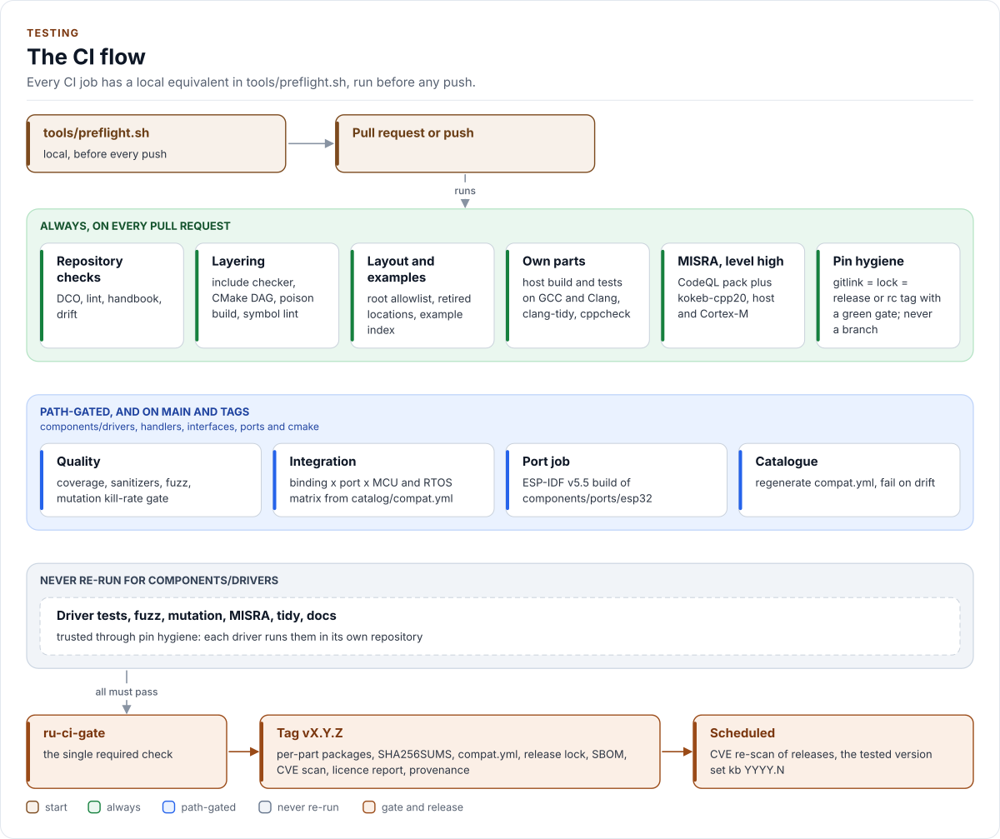

# Testing and CI

## Per part

| Part | Unit tests | Fuzz | Mutation | Other |
| --- | --- | --- | --- | --- |
| utils | Every function, boundaries, `static_assert` tests, compile-fail tests | containers, CRCs, curves | yes | Coverage goal 100 % branch |
| rtos | `none` backend with the fake clock; FreeRTOS and ThreadX boundaries over fake kernels; the threaded suite on std::thread and on the ThreadX Linux port | queue and flag sequences | yes | ThreadSanitizer, ESP32 builds, ThreadX backend and kernel for Cortex-M0+, M4F, M7F |
| interfaces | Concept conformance per port, compile-fail tests, host fault injection | loopback bus scripts | yes | ESP-IDF build of the ESP32 port |
| handlers | Bindings over host ports and chip models; start-up plans stage by stage; both thread models; health transitions | command sequences | yes | Integration matrix, TSan on both facades |
| components/ports/esp32 | Link-seam host tests of each boundary file | - | - | ESP-IDF v5.5 build of its examples |

## Coverage and mutation

- **Coverage:** 100 % of lines and branches of the library code (`components/lib/<part>/inc`, the RTOS backends) is the
  target and the current state. Tests pass their inputs through `kb_test::Rt()` (a volatile copy), so a
  `constexpr` function runs at run time and is measured, instead of being folded by the compiler.
- **Mutation:** level `high`, enforced: every scored mutant is killed. A mutant that cannot change behaviour (an
  initial value every path overwrites, a comparison whose two forms agree at the only value where they differ, a
  compile-time margin) is listed in `docs/assurance/equivalent-mutants.yml` with its reason; never deleted.
- Locally: `tools/preflight.sh --container` runs coverage, sanitizers and fuzzing in the CI image.

## CI

<!-- figure: ci-flow -->
<picture>
  <source media="(prefers-color-scheme: dark)" srcset="diagrams/ci-flow.dark.svg">
  
</picture>
<!-- /figure -->

| Check | Workflow | ci-tools reusable workflow |
| --- | --- | --- |
| Host build, tests, clang-tidy, cppcheck | `ci-host.yml` | `ru-host-ci` |
| Coverage, sanitizers, fuzz, complexity (level `high`) | `ci-quality.yml` | `ru-host-quality` |
| MISRA C++:2023 and KB-CPP20 (level `high`) | `ci-misra.yml` | `ru-misra` |
| Cortex-M cross build | `ci-cross-build.yml` | `ru-cross-build` |
| ESP32 port and its examples | `ci-esp32.yml` | `ru-build` |
| Docs | `ci-docs.yml` | `ru-mkdocs-publish` |
| DCO, org standard, lint, handbook, drift | `ci-repo-checks.yml` | `ru-repo-checks` |
| Each part alone, install consumers | `ci-standalone.yml` | `ru-cmake-matrix` |
| Integration of pinned drivers | `ci-integration.yml` | `ru-cmake-matrix`, `ru-host-ci` |
| Mutation | `ci-mutation.yml` | `ru-mutation` |
| Pin hygiene | `ci-pins.yml` | `ru-pin-hygiene` |
| Layering and poison build | `ci-layering.yml` | `ru-layering` |
| compat.yml | `ci-catalog.yml` | `ru-catalog` |
| Layout allowlist, retired locations, example index | `ci-layout.yml` | - (`tools/layout`, `tools/examples`) |
| Release lock, SBOM, CVE scan, licence report | `release.yml` | `ru-release-evidence` |

**Not re-run for driver content**: unit tests, coverage, mutation, fuzzing, MISRA, clang-tidy, cppcheck,
complexity and handbook checks of the drivers. Each pinned driver passed them in its own CI at its release tag;
pin hygiene proves the pin is that tag ([ADR-0004](adr/ADR-0004-ci-strategy.md)).
